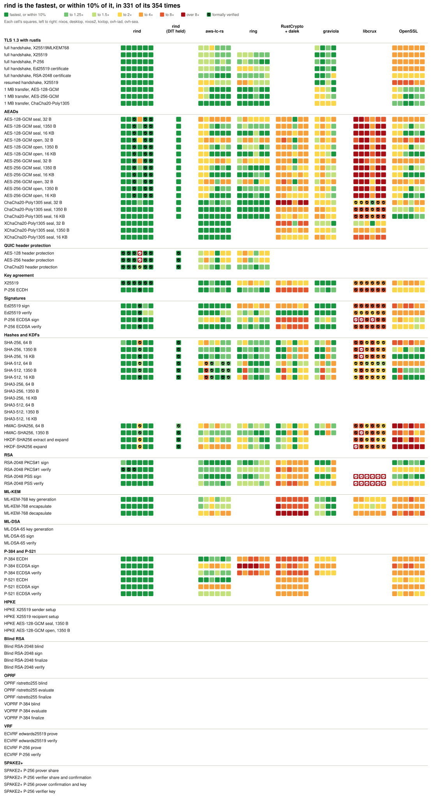
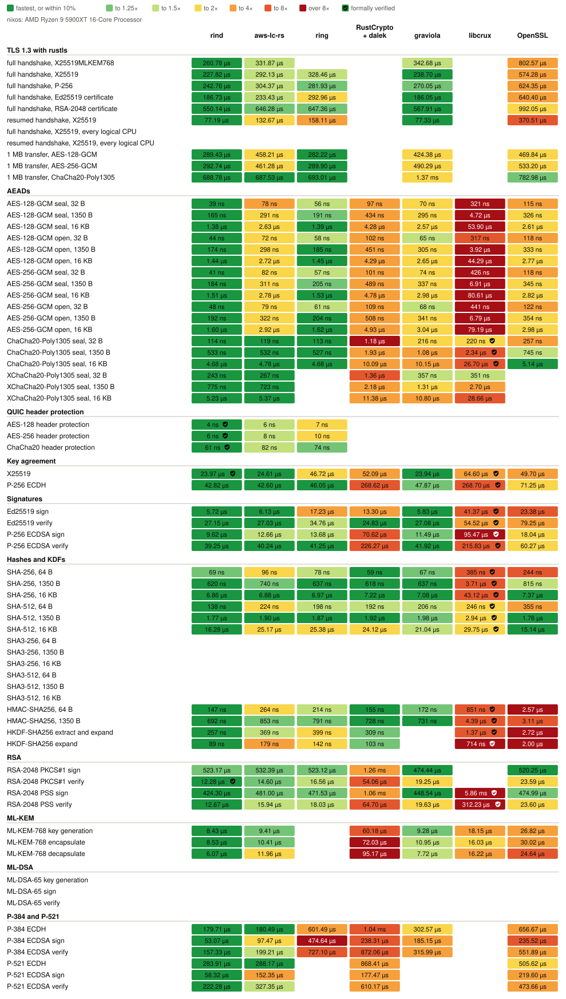
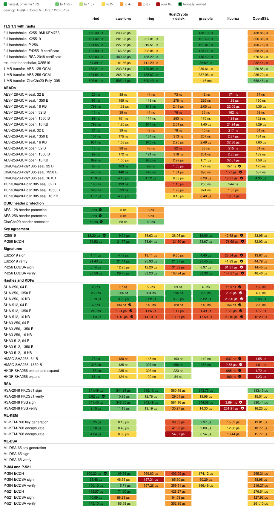
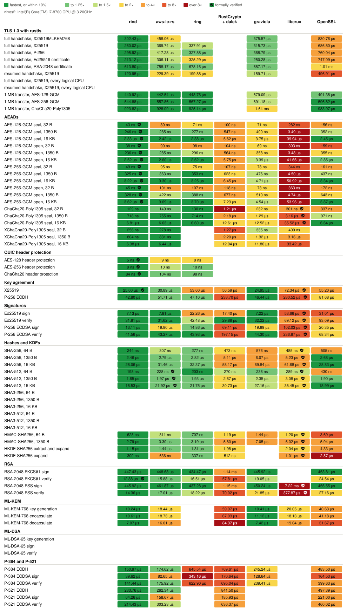
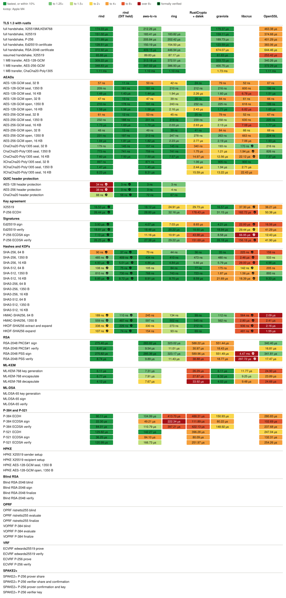
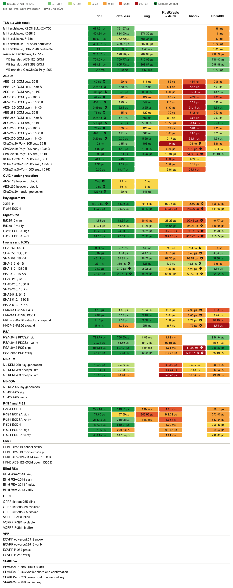
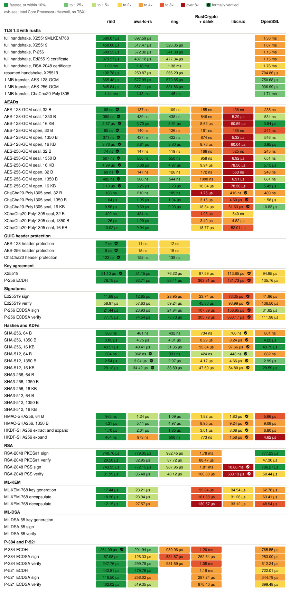
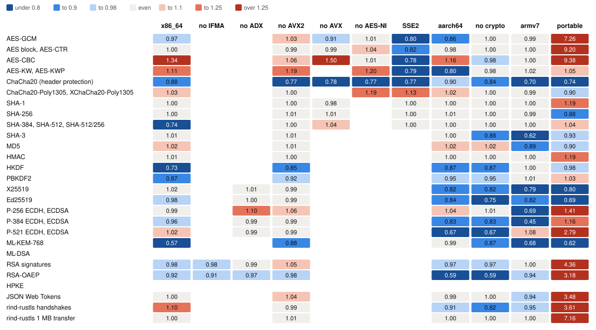

# Benchmarks

<!-- Generated by `admin/bench-report render` from benchmarks/data, benchmarks/verified.toml, and benchmarks/gaps.toml. -->

How long rind and the usual Rust crypto libraries take for the same operations, on six machines, and what each costs to build. Every library runs its native path on each host. A ✓ marks an operation whose whole computation a published formal proof covers, as [Verified code](#verified-code) lists.

## Hosts

| Host | CPU | OS | Measured |
|---|---|---|---|
| `nixos` | AMD Ryzen 9 5900XT 16-Core Processor | NixOS 26.11 (Zokor) (Linux 6.18.56) | 2026-11-06 at [`f95b91da`](https://github.com/kixel-ai/rind/commit/f95b91da886bee265dbd836192a7ade2f9158c47), noisy |
| `desktop` | Intel(R) Core(TM) Ultra 7 270K Plus | Ubuntu 26.04.1 LTS (Linux 7.0.0-42-generic) | 2026-11-07 at [`9e7f6a5a`](https://github.com/kixel-ai/rind/commit/9e7f6a5a9ea59a0cf1251c24af6c5d4f21c2b0fd) |
| `nixos2` | Intel(R) Core(TM) i7-8700 CPU @ 3.20GHz | NixOS 26.11 (Zokor) (Linux 6.18.56) | 2026-11-06 at [`f95b91da`](https://github.com/kixel-ai/rind/commit/f95b91da886bee265dbd836192a7ade2f9158c47) |
| `kixtop` | Apple M4 | macOS 26.6.2 (25.6.0) | 2026-11-07 at [`9e7f6a5a`](https://github.com/kixel-ai/rind/commit/9e7f6a5a9ea59a0cf1251c24af6c5d4f21c2b0fd) |
| `ovh-iad` | Intel Core Processor (Haswell, no TSX) | NixOS 26.11 (Zokor) (Linux 6.18.40) | 2026-11-06 at [`6b185382`](https://github.com/kixel-ai/rind/commit/6b185382a621d6ffe630db4118adc464bc4d158a) |
| `ovh-sea` | Intel Core Processor (Haswell, no TSX) | NixOS 26.11 (Zokor) (Linux 6.18.40) | 2026-11-06 at [`6b185382`](https://github.com/kixel-ai/rind/commit/6b185382a621d6ffe630db4118adc464bc4d158a) |

Each host builds with the pinned toolchain in the Nix dev shell, and runs `admin/bench-report` only when idle. Times are criterion's estimates.

## Speed

Each row is one operation and each column one library. Each cell holds a square per host, colored by that library's time over the fastest library's on the same host, as the legend shows. A shield in a square marks verified code. Each square's tooltip, in the SVG opened on its own, gives its time; the tables below each host give them all. A library with no square doesn't offer the operation, or the host didn't time it, as its section says.

rind (DIT held) times rind with `rind::cpu::Dit::hold()` held across the timed loop, as a caller batching calls does, so that DIT is set once rather than around each call. Only an Apple CPU times it, since elsewhere it runs the same code as rind's own column, and it never counts as the fastest library.

<picture>
  <source media="(prefers-color-scheme: dark)" srcset="benchmarks/overview-dark.svg">
  
</picture>

### `nixos`: AMD Ryzen 9 5900XT 16-Core Processor

Measured 2026-11-06 at [`f95b91da`](https://github.com/kixel-ai/rind/commit/f95b91da886bee265dbd836192a7ade2f9158c47), noisy, on NixOS 26.11 (Zokor) (Linux 6.18.56) with rustc 1.98.1 (48a229cea 2026-09-01).

Not timed on `nixos`: SHA3-256, 64 B, SHA3-256, 1350 B, SHA3-256, 16 KB, SHA3-512, 64 B, SHA3-512, 1350 B, SHA3-512, 16 KB, ML-DSA-65 key generation, ML-DSA-65 sign, ML-DSA-65 verify.

<picture>
  <source media="(prefers-color-scheme: dark)" srcset="benchmarks/nixos-dark.svg">
  
</picture>

Times on nixos

| Operation | rind | aws-lc-rs | ring | RustCrypto + dalek | graviola | libcrux | OpenSSL |
|---|---|---|---|---|---|---|---|
| full handshake, X25519MLKEM768 | 260.78 µs | 331.87 µs | - | - | 342.68 µs | - | 802.57 µs |
| full handshake, X25519 | 227.82 µs | 292.13 µs | 328.46 µs | - | 238.70 µs | - | 574.28 µs |
| full handshake, P-256 | 242.76 µs | 304.37 µs | 281.93 µs | - | 270.05 µs | - | 624.35 µs |
| full handshake, Ed25519 certificate | 186.73 µs | 233.43 µs | 292.96 µs | - | 186.05 µs | - | 640.40 µs |
| full handshake, RSA-2048 certificate | 550.14 µs | 646.28 µs | 647.36 µs | - | 567.91 µs | - | 992.05 µs |
| resumed handshake, X25519 | 77.19 µs | 132.67 µs | 158.11 µs | - | 77.33 µs | - | 370.51 µs |
| 1 MB transfer, AES-128-GCM | 289.43 µs | 458.21 µs | 282.22 µs | - | 424.38 µs | - | 469.84 µs |
| 1 MB transfer, AES-256-GCM | 292.74 µs | 461.28 µs | 289.90 µs | - | 490.29 µs | - | 533.20 µs |
| 1 MB transfer, ChaCha20-Poly1305 | 688.78 µs | 687.53 µs | 693.01 µs | - | 1.37 ms | - | 782.98 µs |
| AES-128-GCM seal, 32 B | 39 ns | 78 ns | 56 ns | 97 ns | 70 ns | 321 ns | 115 ns |
| AES-128-GCM seal, 1350 B | 165 ns | 291 ns | 191 ns | 434 ns | 295 ns | 4.72 µs | 326 ns |
| AES-128-GCM seal, 16 KB | 1.38 µs | 2.63 µs | 1.39 µs | 4.28 µs | 2.57 µs | 53.90 µs | 2.61 µs |
| AES-128-GCM open, 32 B | 44 ns | 72 ns | 58 ns | 102 ns | 65 ns | 317 ns | 118 ns |
| AES-128-GCM open, 1350 B | 174 ns | 298 ns | 185 ns | 451 ns | 305 ns | 3.92 µs | 333 ns |
| AES-128-GCM open, 16 KB | 1.44 µs | 2.72 µs | 1.45 µs | 4.29 µs | 2.65 µs | 44.29 µs | 2.77 µs |
| AES-256-GCM seal, 32 B | 41 ns | 82 ns | 57 ns | 101 ns | 74 ns | 426 ns | 118 ns |
| AES-256-GCM seal, 1350 B | 184 ns | 311 ns | 205 ns | 489 ns | 337 ns | 6.91 µs | 345 ns |
| AES-256-GCM seal, 16 KB | 1.51 µs | 2.78 µs | 1.53 µs | 4.78 µs | 2.98 µs | 80.61 µs | 2.82 µs |
| AES-256-GCM open, 32 B | 48 ns | 79 ns | 61 ns | 109 ns | 68 ns | 441 ns | 122 ns |
| AES-256-GCM open, 1350 B | 192 ns | 322 ns | 204 ns | 508 ns | 341 ns | 6.79 µs | 354 ns |
| AES-256-GCM open, 16 KB | 1.60 µs | 2.92 µs | 1.62 µs | 4.93 µs | 3.04 µs | 79.19 µs | 2.98 µs |
| ChaCha20-Poly1305 seal, 32 B | 114 ns | 119 ns | 113 ns | 1.18 µs | 216 ns | 220 ns ✓ | 257 ns |
| ChaCha20-Poly1305 seal, 1350 B | 533 ns | 532 ns | 527 ns | 1.93 µs | 1.08 µs | 2.34 µs ✓ | 745 ns |
| ChaCha20-Poly1305 seal, 16 KB | 4.68 µs | 4.78 µs | 4.68 µs | 10.09 µs | 10.15 µs | 26.70 µs ✓ | 5.14 µs |
| XChaCha20-Poly1305 seal, 32 B | 243 ns | 267 ns | - | 1.36 µs | 357 ns | 351 ns | - |
| XChaCha20-Poly1305 seal, 1350 B | 775 ns | 723 ns | - | 2.18 µs | 1.31 µs | 2.70 µs | - |
| XChaCha20-Poly1305 seal, 16 KB | 5.23 µs | 5.37 µs | - | 11.38 µs | 10.80 µs | 28.66 µs | - |
| AES-128 header protection | 4 ns ✓ | 6 ns | 7 ns | - | - | - | - |
| AES-256 header protection | 6 ns ✓ | 8 ns | 10 ns | - | - | - | - |
| ChaCha20 header protection | 61 ns ✓ | 82 ns | 74 ns | - | - | - | - |
| X25519 | 23.97 µs ✓ | 24.61 µs | 46.72 µs | 52.09 µs | 23.94 µs | 64.60 µs ✓ | 49.70 µs |
| P-256 ECDH | 42.82 µs | 42.60 µs | 46.05 µs | 268.62 µs | 47.87 µs | 268.70 µs ✓ | 71.25 µs |
| Ed25519 sign | 5.72 µs | 6.13 µs | 17.23 µs | 13.30 µs | 5.83 µs | 41.37 µs ✓ | 23.38 µs |
| Ed25519 verify | 27.15 µs | 27.03 µs | 34.76 µs | 24.83 µs | 27.08 µs | 54.52 µs ✓ | 79.25 µs |
| P-256 ECDSA sign | 9.62 µs | 12.66 µs | 13.68 µs | 70.62 µs | 11.49 µs | 95.47 µs ✓ | 18.04 µs |
| P-256 ECDSA verify | 39.25 µs | 40.24 µs | 41.25 µs | 226.27 µs | 41.92 µs | 215.83 µs ✓ | 60.27 µs |
| SHA-256, 64 B | 69 ns | 96 ns | 78 ns | 59 ns | 67 ns | 385 ns ✓ | 244 ns |
| SHA-256, 1350 B | 620 ns | 740 ns | 637 ns | 618 ns | 637 ns | 3.71 µs ✓ | 815 ns |
| SHA-256, 16 KB | 6.86 µs | 6.88 µs | 6.97 µs | 7.22 µs | 7.08 µs | 43.12 µs ✓ | 7.37 µs |
| SHA-512, 64 B | 138 ns | 224 ns | 198 ns | 192 ns | 206 ns | 246 ns ✓ | 355 ns |
| SHA-512, 1350 B | 1.77 µs | 1.90 µs | 1.87 µs | 1.92 µs | 1.98 µs | 2.94 µs ✓ | 1.76 µs |
| SHA-512, 16 KB | 16.28 µs | 25.17 µs | 25.38 µs | 24.12 µs | 21.04 µs | 29.75 µs ✓ | 15.14 µs |
| SHA3-256, 64 B | - | - | - | - | - | - | - |
| SHA3-256, 1350 B | - | - | - | - | - | - | - |
| SHA3-256, 16 KB | - | - | - | - | - | - | - |
| SHA3-512, 64 B | - | - | - | - | - | - | - |
| SHA3-512, 1350 B | - | - | - | - | - | - | - |
| SHA3-512, 16 KB | - | - | - | - | - | - | - |
| HMAC-SHA256, 64 B | 147 ns | 264 ns | 214 ns | 155 ns | 172 ns | 851 ns ✓ | 2.57 µs |
| HMAC-SHA256, 1350 B | 692 ns | 853 ns | 791 ns | 728 ns | 731 ns | 4.39 µs ✓ | 3.11 µs |
| HKDF-SHA256 extract and expand | 257 ns | 369 ns | 399 ns | 309 ns | - | 1.37 µs ✓ | 2.72 µs |
| HKDF-SHA256 expand | 89 ns | 179 ns | 142 ns | 103 ns | - | 714 ns ✓ | 2.00 µs |
| RSA-2048 PKCS#1 sign | 523.17 µs | 532.39 µs | 523.12 µs | 1.26 ms | 474.44 µs | - | 520.25 µs |
| RSA-2048 PKCS#1 verify | 12.28 µs ✓ | 14.60 µs | 16.56 µs | 54.06 µs | 19.25 µs | - | 23.59 µs |
| RSA-2048 PSS sign | 424.30 µs | 481.00 µs | 471.53 µs | 1.06 ms | 448.54 µs | 5.86 ms ✓ | 474.99 µs |
| RSA-2048 PSS verify | 12.67 µs | 15.94 µs | 18.03 µs | 64.70 µs | 19.63 µs | 312.23 µs ✓ | 23.60 µs |
| ML-KEM-768 key generation | 8.43 µs | 9.41 µs | - | 60.18 µs | 9.28 µs | 18.15 µs | 26.82 µs |
| ML-KEM-768 encapsulate | 8.53 µs | 10.41 µs | - | 72.03 µs | 10.95 µs | 16.03 µs | 30.02 µs |
| ML-KEM-768 decapsulate | 6.07 µs | 11.96 µs | - | 95.17 µs | 7.72 µs | 16.22 µs | 24.64 µs |
| ML-DSA-65 key generation | - | - | - | - | - | - | - |
| ML-DSA-65 sign | - | - | - | - | - | - | - |
| ML-DSA-65 verify | - | - | - | - | - | - | - |
| P-384 ECDH | 179.71 µs | 180.49 µs | 601.49 µs | 1.04 ms | 302.57 µs | - | 656.67 µs |
| P-384 ECDSA sign | 53.07 µs | 97.47 µs | 474.64 µs | 238.31 µs | 185.15 µs | - | 235.52 µs |
| P-384 ECDSA verify | 157.33 µs | 199.21 µs | 727.10 µs | 872.06 µs | 315.99 µs | - | 551.89 µs |
| P-521 ECDH | 283.91 µs | 288.17 µs | - | 868.41 µs | - | - | 505.62 µs |
| P-521 ECDSA sign | 58.32 µs | 152.35 µs | - | 177.47 µs | - | - | 219.60 µs |
| P-521 ECDSA verify | 222.28 µs | 327.35 µs | - | 610.17 µs | - | - | 473.66 µs |

### `desktop`: Intel(R) Core(TM) Ultra 7 270K Plus

Measured 2026-11-07 at [`9e7f6a5a`](https://github.com/kixel-ai/rind/commit/9e7f6a5a9ea59a0cf1251c24af6c5d4f21c2b0fd), on Ubuntu 26.04.1 LTS (Linux 7.0.0-42-generic) with rustc 1.98.1 (48a229cea 2026-09-01).

Not timed on `desktop`: SHA3-256, 64 B, SHA3-256, 1350 B, SHA3-256, 16 KB, SHA3-512, 64 B, SHA3-512, 1350 B, SHA3-512, 16 KB, ML-DSA-65 key generation, ML-DSA-65 sign, ML-DSA-65 verify.

<picture>
  <source media="(prefers-color-scheme: dark)" srcset="benchmarks/desktop-dark.svg">
  
</picture>

Times on desktop

| Operation | rind | aws-lc-rs | ring | RustCrypto + dalek | graviola | libcrux | OpenSSL |
|---|---|---|---|---|---|---|---|
| full handshake, X25519MLKEM768 | 172.30 µs | 233.73 µs | - | - | 188.19 µs | - | 438.88 µs |
| full handshake, X25519 | 151.32 µs | 201.93 µs | 221.01 µs | - | 161.40 µs | - | 366.38 µs |
| full handshake, P-256 | 174.55 µs | 227.86 µs | 219.51 µs | - | 191.81 µs | - | 400.76 µs |
| full handshake, Ed25519 certificate | 121.90 µs | 166.63 µs | 202.04 µs | - | 123.71 µs | - | 368.21 µs |
| full handshake, RSA-2048 certificate | 432.83 µs | 480.43 µs | 488.22 µs | - | 440.42 µs | - | 670.54 µs |
| resumed handshake, X25519 | 54.39 µs | 101.36 µs | 111.29 µs | - | 55.62 µs | - | 232.44 µs |
| 1 MB transfer, AES-128-GCM | 168.21 µs | 233.34 µs | 170.08 µs | - | 289.61 µs | - | 250.85 µs |
| 1 MB transfer, AES-256-GCM | 184.54 µs | 265.29 µs | 188.67 µs | - | 337.96 µs | - | 285.79 µs |
| 1 MB transfer, ChaCha20-Poly1305 | 596.91 µs | 595.41 µs | 590.49 µs | - | 1.16 ms | - | 658.48 µs |
| AES-128-GCM seal, 32 B | 20 ns | 38 ns | 41 ns | 73 ns | 42 ns | 171 ns | 57 ns |
| AES-128-GCM seal, 1350 B | 93 ns | 159 ns | 119 ns | 278 ns | 226 ns | 1.98 µs | 160 ns |
| AES-128-GCM seal, 16 KB | 799 ns | 1.32 µs | 818 ns | 2.49 µs | 2.05 µs | 22.05 µs | 1.35 µs |
| AES-128-GCM open, 32 B | 15 ns | 38 ns | 41 ns | 78 ns | 36 ns | 162 ns | 59 ns |
| AES-128-GCM open, 1350 B | 89 ns | 151 ns | 114 ns | 283 ns | 175 ns | 1.99 µs | 162 ns |
| AES-128-GCM open, 16 KB | 793 ns | 1.26 µs | 814 ns | 2.51 µs | 1.40 µs | 21.94 µs | 1.29 µs |
| AES-256-GCM seal, 32 B | 21 ns | 39 ns | 43 ns | 78 ns | 45 ns | 217 ns | 61 ns |
| AES-256-GCM seal, 1350 B | 107 ns | 175 ns | 134 ns | 313 ns | 257 ns | 2.87 µs | 184 ns |
| AES-256-GCM seal, 16 KB | 954 ns | 1.58 µs | 975 ns | 2.90 µs | 2.46 µs | 32.86 µs | 1.60 µs |
| AES-256-GCM open, 32 B | 16 ns | 38 ns | 43 ns | 82 ns | 38 ns | 215 ns | 61 ns |
| AES-256-GCM open, 1350 B | 99 ns | 172 ns | 121 ns | 318 ns | 201 ns | 2.85 µs | 189 ns |
| AES-256-GCM open, 16 KB | 899 ns | 1.55 µs | 933 ns | 2.92 µs | 1.71 µs | 32.61 µs | 1.58 µs |
| ChaCha20-Poly1305 seal, 32 B | 98 ns | 103 ns | 99 ns | 1.05 µs | 177 ns | 157 ns ✓ | 175 ns |
| ChaCha20-Poly1305 seal, 1350 B | 440 ns | 446 ns | 448 ns | 1.64 µs | 890 ns | 1.77 µs ✓ | 587 ns |
| ChaCha20-Poly1305 seal, 16 KB | 4.19 µs | 4.13 µs | 4.12 µs | 8.03 µs | 8.29 µs | 19.31 µs ✓ | 4.35 µs |
| XChaCha20-Poly1305 seal, 32 B | 186 ns | 199 ns | - | 1.15 µs | 255 ns | 244 ns | - |
| XChaCha20-Poly1305 seal, 1350 B | 529 ns | 539 ns | - | 1.73 µs | 974 ns | 1.83 µs | - |
| XChaCha20-Poly1305 seal, 16 KB | 4.17 µs | 4.23 µs | - | 8.15 µs | 8.40 µs | 19.61 µs | - |
| AES-128 header protection | 2 ns ✓ | 3 ns | 3 ns | - | - | - | - |
| AES-256 header protection | 2 ns ✓ | 5 ns | 5 ns | - | - | - | - |
| ChaCha20 header protection | 53 ns ✓ | 68 ns | 60 ns | - | - | - | - |
| X25519 | 18.20 µs ✓ | 19.24 µs | 35.63 µs | 36.06 µs | 18.09 µs | 42.68 µs ✓ | 33.95 µs |
| P-256 ECDH | 29.52 µs | 31.77 µs | 33.64 µs | 121.30 µs | 33.67 µs | 171.68 µs ✓ | 52.92 µs |
| Ed25519 sign | 4.11 µs | 4.49 µs | 13.11 µs | 9.60 µs | 4.40 µs | 28.54 µs ✓ | 13.67 µs |
| Ed25519 verify | 21.43 µs | 21.41 µs | 25.93 µs | 21.87 µs | 21.45 µs | 41.83 µs ✓ | 44.79 µs |
| P-256 ECDSA sign | 6.74 µs | 12.25 µs | 12.20 µs | 31.32 µs | 8.97 µs | 61.81 µs ✓ | 14.45 µs |
| P-256 ECDSA verify | 30.59 µs | 29.75 µs | 33.23 µs | 103.24 µs | 32.36 µs | 147.27 µs ✓ | 46.46 µs |
| SHA-256, 64 B | 28 ns | 57 ns | 56 ns | 39 ns | 40 ns | 218 ns ✓ | 158 ns |
| SHA-256, 1350 B | 269 ns | 306 ns | 304 ns | 296 ns | 292 ns | 2.29 µs ✓ | 406 ns |
| SHA-256, 16 KB | 3.19 µs | 3.23 µs | 3.22 µs | 3.22 µs | 3.22 µs | 26.90 µs ✓ | 3.36 µs |
| SHA-512, 64 B | 60 ns | 134 ns ✓ | 140 ns | 120 ns | 148 ns | 166 ns ✓ | 226 ns |
| SHA-512, 1350 B | 249 ns | 1.24 µs ✓ | 1.26 µs | 1.17 µs | 1.49 µs | 1.72 µs ✓ | 1.17 µs |
| SHA-512, 16 KB | 2.63 µs | 14.12 µs ✓ | 14.10 µs | 13.51 µs | 17.50 µs | 20.10 µs ✓ | 12.29 µs |
| SHA3-256, 64 B | - | - | - | - | - | - | - |
| SHA3-256, 1350 B | - | - | - | - | - | - | - |
| SHA3-256, 16 KB | - | - | - | - | - | - | - |
| SHA3-512, 64 B | - | - | - | - | - | - | - |
| SHA3-512, 1350 B | - | - | - | - | - | - | - |
| SHA3-512, 16 KB | - | - | - | - | - | - | - |
| HMAC-SHA256, 64 B | 75 ns | 180 ns | 145 ns | 103 ns | 110 ns | 537 ns ✓ | 1.55 µs |
| HMAC-SHA256, 1350 B | 328 ns | 435 ns | 397 ns | 356 ns | 358 ns | 2.68 µs ✓ | 1.81 µs |
| HKDF-SHA256 extract and expand | 158 ns | 285 ns | 303 ns | 223 ns | - | 965 ns ✓ | 1.72 µs |
| HKDF-SHA256 expand | 66 ns | 124 ns | 120 ns | 84 ns | - | 480 ns ✓ | 1.23 µs |
| RSA-2048 PKCS#1 sign | 341.49 µs | 344.24 µs | 336.10 µs | 580.18 µs | 343.75 µs | - | 393.45 µs |
| RSA-2048 PKCS#1 verify | 8.92 µs ✓ | 10.96 µs | 12.78 µs | 29.01 µs | 13.98 µs | - | 15.51 µs |
| RSA-2048 PSS sign | 341.45 µs | 346.55 µs | 342.49 µs | 581.16 µs | 344.58 µs | 3.69 ms ✓ | 390.44 µs |
| RSA-2048 PSS verify | 9.15 µs | 11.16 µs | 13.19 µs | 35.27 µs | 14.30 µs | 251.91 µs ✓ | 16.25 µs |
| ML-KEM-768 key generation | 6.35 µs | 8.13 µs | - | 39.63 µs | 7.37 µs | 15.02 µs | 19.81 µs |
| ML-KEM-768 encapsulate | 6.50 µs | 8.48 µs | - | 41.38 µs | 9.00 µs | 12.80 µs | 18.77 µs |
| ML-KEM-768 decapsulate | 4.64 µs | 8.90 µs | - | 54.87 µs | 6.54 µs | 13.44 µs | 15.77 µs |
| ML-DSA-65 key generation | - | - | - | - | - | - | - |
| ML-DSA-65 sign | - | - | - | - | - | - | - |
| ML-DSA-65 verify | - | - | - | - | - | - | - |
| P-384 ECDH | 100.20 µs | 109.34 µs | 369.83 µs | 402.09 µs | 174.12 µs | - | 265.21 µs |
| P-384 ECDSA sign | 23.48 µs | 46.55 µs | 197.31 µs | 85.50 µs | 90.29 µs | - | 88.98 µs |
| P-384 ECDSA verify | 100.10 µs | 115.71 µs | 357.26 µs | 359.61 µs | 166.49 µs | - | 216.27 µs |
| P-521 ECDH | 159.57 µs | 171.50 µs | - | 428.27 µs | - | - | 276.64 µs |
| P-521 ECDSA sign | 40.09 µs | 88.28 µs | - | 94.09 µs | - | - | 127.93 µs |
| P-521 ECDSA verify | 145.10 µs | 186.69 µs | - | 352.95 µs | - | - | 261.10 µs |

### `nixos2`: Intel(R) Core(TM) i7-8700 CPU @ 3.20GHz

Measured 2026-11-06 at [`f95b91da`](https://github.com/kixel-ai/rind/commit/f95b91da886bee265dbd836192a7ade2f9158c47), on NixOS 26.11 (Zokor) (Linux 6.18.56) with rustc 1.98.1 (48a229cea 2026-09-01).

Not timed on `nixos2`: SHA3-256, 64 B, SHA3-256, 1350 B, SHA3-256, 16 KB, SHA3-512, 64 B, SHA3-512, 1350 B, SHA3-512, 16 KB, ML-DSA-65 key generation, ML-DSA-65 sign, ML-DSA-65 verify.

<picture>
  <source media="(prefers-color-scheme: dark)" srcset="benchmarks/nixos2-dark.svg">
  
</picture>

Times on nixos2

| Operation | rind | aws-lc-rs | ring | RustCrypto + dalek | graviola | libcrux | OpenSSL |
|---|---|---|---|---|---|---|---|
| full handshake, X25519MLKEM768 | 302.43 µs | 458.06 µs | - | - | 375.57 µs | - | 830.76 µs |
| full handshake, X25519 | 260.02 µs | 369.74 µs | 337.91 µs | - | 315.73 µs | - | 686.50 µs |
| full handshake, P-256 | 295.92 µs | 417.28 µs | 327.88 µs | - | 368.79 µs | - | 760.04 µs |
| full handshake, Ed25519 certificate | 213.12 µs | 306.11 µs | 325.29 µs | - | 250.28 µs | - | 747.09 µs |
| full handshake, RSA-2048 certificate | 613.80 µs | 758.17 µs | 678.16 µs | - | 687.17 µs | - | 1.01 ms |
| resumed handshake, X25519 | 120.95 µs | 229.39 µs | 199.88 µs | - | 159.71 µs | - | 496.91 µs |
| 1 MB transfer, AES-128-GCM | 440.92 µs | 442.54 µs | 448.76 µs | - | 579.09 µs | - | 491.38 µs |
| 1 MB transfer, AES-256-GCM | 544.88 µs | 557.86 µs | 567.27 µs | - | 691.18 µs | - | 596.82 µs |
| 1 MB transfer, ChaCha20-Poly1305 | 923.82 µs | 928.09 µs | 925.14 µs | - | 1.64 ms | - | 983.97 µs |
| AES-128-GCM seal, 32 B | 43 ns ✓ | 89 ns | 71 ns | 100 ns | 71 ns | 282 ns | 156 ns |
| AES-128-GCM seal, 1350 B | 246 ns ✓ | 285 ns | 277 ns | 547 ns | 400 ns | 3.49 µs | 352 ns |
| AES-128-GCM seal, 16 KB | 2.33 µs ✓ | 2.42 µs | 2.38 µs | 5.62 µs | 3.75 µs | 39.94 µs | 2.45 µs |
| AES-128-GCM open, 32 B | 38 ns ✓ | 90 ns | 98 ns | 104 ns | 69 ns | 303 ns | 159 ns |
| AES-128-GCM open, 1350 B | 236 ns ✓ | 285 ns | 296 ns | 564 ns | 358 ns | 3.48 µs | 355 ns |
| AES-128-GCM open, 16 KB | 2.52 µs ✓ | 2.60 µs | 2.62 µs | 5.75 µs | 3.39 µs | 41.66 µs | 2.85 µs |
| AES-256-GCM seal, 32 B | 49 ns ✓ | 95 ns | 75 ns | 107 ns | 78 ns | 344 ns | 161 ns |
| AES-256-GCM seal, 1350 B | 325 ns ✓ | 363 ns | 353 ns | 623 ns | 476 ns | 4.50 µs | 437 ns |
| AES-256-GCM seal, 16 KB | 3.22 µs ✓ | 3.30 µs | 3.25 µs | 6.45 µs | 4.71 µs | 50.92 µs | 3.34 µs |
| AES-256-GCM open, 32 B | 45 ns ✓ | 101 ns | 107 ns | 118 ns | 73 ns | 363 ns | 172 ns |
| AES-256-GCM open, 1350 B | 328 ns ✓ | 422 ns | 388 ns | 677 ns | 510 ns | 4.74 µs | 643 ns |
| AES-256-GCM open, 16 KB | 3.62 µs ✓ | 3.69 µs | 3.70 µs | 7.23 µs | 4.54 µs | 53.96 µs | 3.87 µs |
| ChaCha20-Poly1305 seal, 32 B | 129 ns | 149 ns | 130 ns | 1.21 µs | 232 ns | 301 ns ✓ | 337 ns |
| ChaCha20-Poly1305 seal, 1350 B | 718 ns | 755 ns | 714 ns | 2.18 µs | 1.29 µs | 3.16 µs ✓ | 971 ns |
| ChaCha20-Poly1305 seal, 16 KB | 6.81 µs | 6.63 µs | 6.60 µs | 12.61 µs | 12.52 µs | 35.52 µs ✓ | 6.64 µs |
| XChaCha20-Poly1305 seal, 32 B | 256 ns | 278 ns | - | 1.27 µs | 335 ns | 400 ns | - |
| XChaCha20-Poly1305 seal, 1350 B | 804 ns | 831 ns | - | 2.20 µs | 1.32 µs | 3.16 µs | - |
| XChaCha20-Poly1305 seal, 16 KB | 6.38 µs | 6.44 µs | - | 12.04 µs | 11.86 µs | 33.42 µs | - |
| AES-128 header protection | 5 ns ✓ | 9 ns | 8 ns | - | - | - | - |
| AES-256 header protection | 8 ns ✓ | 10 ns | 10 ns | - | - | - | - |
| ChaCha20 header protection | 84 ns ✓ | 104 ns | 98 ns | - | - | - | - |
| X25519 | 25.00 µs ✓ | 30.89 µs | 53.60 µs | 56.59 µs | 24.95 µs | 72.34 µs ✓ | 55.20 µs |
| P-256 ECDH | 42.80 µs | 51.71 µs | 47.10 µs | 233.70 µs | 46.44 µs | 280.52 µs ✓ | 81.68 µs |
| Ed25519 sign | 7.13 µs | 7.81 µs | 22.26 µs | 17.40 µs | 7.22 µs | 53.66 µs ✓ | 31.01 µs |
| Ed25519 verify | 31.81 µs | 31.62 µs | 42.48 µs | 29.88 µs | 32.22 µs | 69.12 µs ✓ | 93.09 µs |
| P-256 ECDSA sign | 13.11 µs | 19.80 µs | 14.86 µs | 69.11 µs | 19.89 µs | 102.03 µs ✓ | 20.35 µs |
| P-256 ECDSA verify | 41.56 µs | 43.27 µs | 43.93 µs | 197.15 µs | 44.30 µs | 236.87 µs ✓ | 68.34 µs |
| SHA-256, 64 B | 244 ns | 307 ns | 277 ns | 473 ns | 576 ns | 485 ns ✓ | 505 ns |
| SHA-256, 1350 B | 2.46 µs | 2.79 µs | 2.82 µs | 5.11 µs | 6.07 µs | 5.23 µs ✓ | 2.68 µs |
| SHA-256, 16 KB | 28.06 µs | 31.46 µs | 32.37 µs | 58.17 µs | 69.84 µs | 61.68 µs ✓ | 28.83 µs |
| SHA-512, 64 B | 198 ns | 228 ns ✓ | 203 ns | 270 ns | 236 ns | 289 ns ✓ | 430 ns |
| SHA-512, 1350 B | 1.65 µs | 1.97 µs ✓ | 1.93 µs | 2.67 µs | 2.35 µs | 3.08 µs ✓ | 1.90 µs |
| SHA-512, 16 KB | 18.53 µs | 21.92 µs ✓ | 21.75 µs | 30.73 µs | 27.16 µs | 35.45 µs ✓ | 18.99 µs |
| SHA3-256, 64 B | - | - | - | - | - | - | - |
| SHA3-256, 1350 B | - | - | - | - | - | - | - |
| SHA3-256, 16 KB | - | - | - | - | - | - | - |
| SHA3-512, 64 B | - | - | - | - | - | - | - |
| SHA3-512, 1350 B | - | - | - | - | - | - | - |
| SHA3-512, 16 KB | - | - | - | - | - | - | - |
| HMAC-SHA256, 64 B | 628 ns | 811 ns | 707 ns | 1.19 µs | 1.44 µs | 1.20 µs ✓ | 3.69 µs |
| HMAC-SHA256, 1350 B | 2.79 µs | 3.30 µs | 3.19 µs | 5.80 µs | 7.05 µs | 6.02 µs ✓ | 5.94 µs |
| HKDF-SHA256 extract and expand | 1.15 µs | 1.44 µs | 1.31 µs | 1.98 µs | - | 2.04 µs ✓ | 4.33 µs |
| HKDF-SHA256 expand | 300 ns | 636 ns | 337 ns | 512 ns | - | 1.01 µs ✓ | 2.87 µs |
| RSA-2048 PKCS#1 sign | 447.43 µs | 448.68 µs | 434.47 µs | 1.14 ms | 445.92 µs | - | 453.81 µs |
| RSA-2048 PKCS#1 verify | 12.88 µs ✓ | 15.88 µs | 16.51 µs | 57.81 µs | 19.05 µs | - | 24.54 µs |
| RSA-2048 PSS sign | 445.92 µs | 461.87 µs | 437.28 µs | 1.15 ms | 450.24 µs | 7.22 ms ✓ | 456.55 µs |
| RSA-2048 PSS verify | 14.36 µs | 17.01 µs | 18.22 µs | 70.02 µs | 21.85 µs | 377.87 µs ✓ | 27.16 µs |
| ML-KEM-768 key generation | 10.24 µs | 18.44 µs | - | 59.97 µs | 10.41 µs | 20.05 µs | 40.63 µs |
| ML-KEM-768 encapsulate | 10.61 µs | 18.73 µs | - | 67.03 µs | 11.12 µs | 18.13 µs | 41.18 µs |
| ML-KEM-768 decapsulate | 7.07 µs | 16.01 µs | - | 84.37 µs | 7.42 µs | 19.04 µs | 31.67 µs |
| ML-DSA-65 key generation | - | - | - | - | - | - | - |
| ML-DSA-65 sign | - | - | - | - | - | - | - |
| ML-DSA-65 verify | - | - | - | - | - | - | - |
| P-384 ECDH | 150.97 µs | 174.62 µs | 645.54 µs | 769.61 µs | 245.24 µs | - | 483.50 µs |
| P-384 ECDSA sign | 39.62 µs | 82.65 µs | 343.16 µs | 170.64 µs | 128.64 µs | - | 164.53 µs |
| P-384 ECDSA verify | 141.44 µs | 175.92 µs | 622.90 µs | 695.04 µs | 239.41 µs | - | 399.63 µs |
| P-521 ECDH | 233.76 µs | 262.34 µs | - | 841.50 µs | - | - | 497.39 µs |
| P-521 ECDSA sign | 64.26 µs | 158.67 µs | - | 185.93 µs | - | - | 221.00 µs |
| P-521 ECDSA verify | 214.43 µs | 303.23 µs | - | 636.37 µs | - | - | 460.02 µs |

### `kixtop`: Apple M4

Measured 2026-11-07 at [`9e7f6a5a`](https://github.com/kixel-ai/rind/commit/9e7f6a5a9ea59a0cf1251c24af6c5d4f21c2b0fd), on macOS 26.6.2 (25.6.0) with rustc 1.98.1 (48a229cea 2026-09-01).

The maintainer's MacBook, in daily use. Its cores have DIT, which rind sets around each call that handles a secret and the other libraries never set; Known gaps gives its cost.

Not timed on `kixtop`: SHA3-256, 64 B, SHA3-256, 1350 B, SHA3-256, 16 KB, SHA3-512, 64 B, SHA3-512, 1350 B, SHA3-512, 16 KB, ML-DSA-65 key generation, ML-DSA-65 sign, ML-DSA-65 verify.

<picture>
  <source media="(prefers-color-scheme: dark)" srcset="benchmarks/kixtop-dark.svg">
  
</picture>

Times on kixtop

| Operation | rind | rind (DIT held) | aws-lc-rs | ring | RustCrypto + dalek | graviola | libcrux | OpenSSL |
|---|---|---|---|---|---|---|---|---|
| full handshake, X25519MLKEM768 | 174.03 µs | - | 212.26 µs | - | - | 179.37 µs | - | 463.38 µs |
| full handshake, X25519 | 151.02 µs | - | 183.41 µs | 183.82 µs | - | 159.11 µs | - | 374.68 µs |
| full handshake, P-256 | 171.99 µs | - | 205.84 µs | 202.42 µs | - | 189.73 µs | - | 401.29 µs |
| full handshake, Ed25519 certificate | 128.51 µs | - | 150.19 µs | 154.50 µs | - | 123.59 µs | - | 383.06 µs |
| full handshake, RSA-2048 certificate | 372.92 µs | - | 409.15 µs | 446.94 µs | - | 674.07 µs | - | 644.46 µs |
| resumed handshake, X25519 | 65.88 µs | - | 89.83 µs | 87.17 µs | - | 61.63 µs | - | 253.42 µs |
| 1 MB transfer, AES-128-GCM | 309.22 µs | - | 313.18 µs | 372.51 µs | - | 333.72 µs | - | 340.26 µs |
| 1 MB transfer, AES-256-GCM | 348.83 µs | - | 347.02 µs | 386.93 µs | - | 400.75 µs | - | 372.29 µs |
| 1 MB transfer, ChaCha20-Poly1305 | 1.11 ms | - | 1.10 ms | 1.10 ms | - | 1.73 ms | - | 1.11 ms |
| AES-128-GCM seal, 32 B | 57 ns | 11 ns | 50 ns | 42 ns | 24 ns | 79 ns | 52 ns | 67 ns |
| AES-128-GCM seal, 1350 B | 209 ns | 161 ns | 181 ns | 210 ns | 212 ns | 216 ns | 600 ns | 196 ns |
| AES-128-GCM seal, 16 KB | 1.48 µs | 1.43 µs | 1.44 µs | 1.94 µs | 2.26 µs | 1.60 µs | 6.78 µs | 1.51 µs |
| AES-128-GCM open, 32 B | 47 ns | 13 ns | 47 ns | 39 ns | 28 ns | 84 ns | 61 ns | 66 ns |
| AES-128-GCM open, 1350 B | 210 ns | 178 ns | 191 ns | 243 ns | 232 ns | 225 ns | 618 ns | 199 ns |
| AES-128-GCM open, 16 KB | 1.58 µs | 1.56 µs | 1.58 µs | 2.16 µs | 2.43 µs | 1.71 µs | 6.82 µs | 1.65 µs |
| AES-256-GCM seal, 32 B | 61 ns | 12 ns | 53 ns | 45 ns | 25 ns | 79 ns | 52 ns | 67 ns |
| AES-256-GCM seal, 1350 B | 232 ns | 188 ns | 201 ns | 219 ns | 239 ns | 258 ns | 630 ns | 220 ns |
| AES-256-GCM seal, 16 KB | 1.73 µs | 1.69 µs | 1.70 µs | 2.03 µs | 2.63 µs | 2.13 µs | 7.08 µs | 1.77 µs |
| AES-256-GCM open, 32 B | 48 ns | 13 ns | 49 ns | 39 ns | 41 ns | 84 ns | 66 ns | 68 ns |
| AES-256-GCM open, 1350 B | 231 ns | 197 ns | 213 ns | 247 ns | 278 ns | 263 ns | 663 ns | 224 ns |
| AES-256-GCM open, 16 KB | 1.84 µs | 1.81 µs | 1.82 µs | 2.23 µs | 2.77 µs | 2.19 µs | 7.06 µs | 1.93 µs |
| ChaCha20-Poly1305 seal, 32 B | 179 ns | 145 ns | 157 ns | 145 ns | 340 ns | 193 ns | 170 ns ✓ | 216 ns |
| ChaCha20-Poly1305 seal, 1350 B | 773 ns | 741 ns | 759 ns | 741 ns | 1.75 µs | 1.21 µs | 1.94 µs ✓ | 826 ns |
| ChaCha20-Poly1305 seal, 16 KB | 7.60 µs | 7.50 µs | 7.50 µs | 7.57 µs | 14.97 µs | 12.56 µs | 22.12 µs ✓ | 7.37 µs |
| XChaCha20-Poly1305 seal, 32 B | 897 ns | - | 871 ns | - | 1.06 µs | 905 ns | 900 ns | - |
| XChaCha20-Poly1305 seal, 1350 B | 1.47 µs | - | 1.45 µs | - | 2.44 µs | 1.94 µs | 2.71 µs | - |
| XChaCha20-Poly1305 seal, 16 KB | 8.23 µs | - | 8.31 µs | - | 15.59 µs | 13.22 µs | 22.43 µs | - |
| AES-128 header protection | 34 ns ✓ | 3 ns ✓ | 3 ns | 3 ns | - | - | - | - |
| AES-256 header protection | 38 ns ✓ | 3 ns ✓ | 3 ns | 4 ns | - | - | - | - |
| ChaCha20 header protection | 88 ns ✓ | 58 ns ✓ | 72 ns | 67 ns | - | - | - | - |
| X25519 | 16.53 µs ✓ | - | 18.12 µs | 24.91 µs | 29.73 µs | 16.57 µs | 37.30 µs ✓ | 36.21 µs |
| P-256 ECDH | 26.44 µs ✓ | - | 28.80 µs | 32.16 µs | 178.43 µs | 31.15 µs | 182.72 µs ✓ | 50.38 µs |
| Ed25519 sign | 3.93 µs ✓ | - | 4.07 µs | 7.03 µs | 8.65 µs | 4.21 µs | 22.00 µs ✓ | 16.56 µs |
| Ed25519 verify | 18.81 µs ✓ | - | 18.48 µs | 20.22 µs | 18.60 µs | 18.94 µs | 29.44 µs ✓ | 41.29 µs |
| P-256 ECDSA sign | 7.13 µs ✓ | - | 11.16 µs | 10.91 µs | 43.98 µs | 8.58 µs | 66.95 µs ✓ | 12.43 µs |
| P-256 ECDSA verify | 26.25 µs ✓ | - | 27.38 µs | 29.22 µs | 151.69 µs | 28.18 µs | 156.18 µs ✓ | 41.90 µs |
| SHA-256, 64 B | 90 ns ✓ | 37 ns ✓ | 70 ns | 44 ns | 36 ns | 35 ns | 225 ns ✓ | 159 ns |
| SHA-256, 1350 B | 485 ns ✓ | 409 ns ✓ | 434 ns | 410 ns | 473 ns | 480 ns | 2.46 µs ✓ | 533 ns |
| SHA-256, 16 KB | 4.93 µs ✓ | 5.01 µs ✓ | 4.86 µs | 4.84 µs | 5.66 µs | 5.79 µs | 29.00 µs ✓ | 4.98 µs |
| SHA-512, 64 B | 108 ns ✓ | 75 ns ✓ | 105 ns | 84 ns | 77 ns | 175 ns | 142 ns ✓ | 205 ns |
| SHA-512, 1350 B | 810 ns ✓ | 730 ns ✓ | 768 ns | 743 ns | 723 ns | 1.87 µs | 1.56 µs ✓ | 893 ns |
| SHA-512, 16 KB | 8.85 µs ✓ | 8.72 µs ✓ | 8.91 µs | 8.70 µs | 8.59 µs | 21.69 µs | 18.39 µs ✓ | 9.33 µs |
| SHA3-256, 64 B | - | - | - | - | - | - | - | - |
| SHA3-256, 1350 B | - | - | - | - | - | - | - | - |
| SHA3-256, 16 KB | - | - | - | - | - | - | - | - |
| SHA3-512, 64 B | - | - | - | - | - | - | - | - |
| SHA3-512, 1350 B | - | - | - | - | - | - | - | - |
| SHA3-512, 16 KB | - | - | - | - | - | - | - | - |
| HMAC-SHA256, 64 B | 189 ns ✓ | 110 ns ✓ | 245 ns | 134 ns | 99 ns | 112 ns | 564 ns ✓ | 2.09 µs |
| HMAC-SHA256, 1350 B | 559 ns ✓ | 487 ns ✓ | 597 ns | 502 ns | 545 ns | 562 ns | 2.80 µs ✓ | 2.41 µs |
| HKDF-SHA256 extract and expand | 338 ns ✓ | 226 ns ✓ | 330 ns | 273 ns | 212 ns | - | 936 ns ✓ | 2.16 µs |
| HKDF-SHA256 expand | 107 ns ✓ | 74 ns ✓ | 154 ns | 93 ns | 69 ns | - | 481 ns ✓ | 1.55 µs |
| RSA-2048 PKCS#1 sign | 275.40 µs | - | 283.82 µs | 323.02 µs | 588.22 µs | 551.44 µs | - | 340.40 µs |
| RSA-2048 PKCS#1 verify | 8.41 µs | - | 9.54 µs | 11.01 µs | 30.97 µs | 18.43 µs | - | 16.81 µs |
| RSA-2048 PSS sign | 275.82 µs | - | 285.36 µs | 323.17 µs | 589.96 µs | 551.49 µs | 4.47 ms ✓ | 341.81 µs |
| RSA-2048 PSS verify | 8.74 µs | - | 9.89 µs | 11.43 µs | 38.88 µs | 18.77 µs | 297.72 µs ✓ | 17.47 µs |
| ML-KEM-768 key generation | 6.11 µs | - | 7.31 µs | - | 26.29 µs | 6.11 µs | 11.77 µs | 24.90 µs |
| ML-KEM-768 encapsulate | 6.77 µs | - | 7.91 µs | - | 27.87 µs | 6.32 µs | 9.25 µs | 23.89 µs |
| ML-KEM-768 decapsulate | 4.12 µs | - | 7.67 µs | - | 33.92 µs | 4.02 µs | 9.48 µs | 24.66 µs |
| ML-DSA-65 key generation | - | - | - | - | - | - | - | - |
| ML-DSA-65 sign | - | - | - | - | - | - | - | - |
| ML-DSA-65 verify | - | - | - | - | - | - | - | - |
| P-384 ECDH | 90.11 µs | - | 104.99 µs | 413.70 µs | 488.31 µs | 150.93 µs | - | 280.83 µs |
| P-384 ECDSA sign | 22.30 µs | - | 49.21 µs | 222.34 µs | 111.89 µs | 80.22 µs | - | 102.69 µs |
| P-384 ECDSA verify | 84.01 µs | - | 110.79 µs | 397.21 µs | 422.13 µs | 148.92 µs | - | 237.68 µs |
| P-521 ECDH | 129.82 µs | - | 142.27 µs | - | 396.28 µs | - | - | 247.04 µs |
| P-521 ECDSA sign | 36.25 µs | - | 84.10 µs | - | 80.09 µs | - | - | 132.31 µs |
| P-521 ECDSA verify | 120.99 µs | - | 166.73 µs | - | 251.97 µs | - | - | 254.26 µs |

### `ovh-iad`: Intel Core Processor (Haswell, no TSX)

Measured 2026-11-06 at [`6b185382`](https://github.com/kixel-ai/rind/commit/6b185382a621d6ffe630db4118adc464bc4d158a), on NixOS 26.11 (Zokor) (Linux 6.18.40) with rustc 1.98.1 (48a229cea 2026-09-01).

OVH VPS in Virginia, 4 shared vCPUs: other tenants add noise that a dedicated host's times lack.

Not timed on `ovh-iad`: SHA3-256, 64 B, SHA3-256, 1350 B, SHA3-256, 16 KB, SHA3-512, 64 B, SHA3-512, 1350 B, SHA3-512, 16 KB, ML-DSA-65 key generation, ML-DSA-65 sign, ML-DSA-65 verify.

graviola isn't timed on `ovh-iad`: it requires ADX, which this CPU lacks.

<picture>
  <source media="(prefers-color-scheme: dark)" srcset="benchmarks/ovh-iad-dark.svg">
  
</picture>

Times on ovh-iad

| Operation | rind | aws-lc-rs | ring | RustCrypto + dalek | libcrux | OpenSSL |
|---|---|---|---|---|---|---|
| full handshake, X25519MLKEM768 | 625.81 µs | 731.87 µs | - | - | - | 1.39 ms |
| full handshake, X25519 | 490.86 µs | 554.00 µs | 571.30 µs | - | - | 1.19 ms |
| full handshake, P-256 | 570.01 µs | 752.60 µs | 601.35 µs | - | - | 1.32 ms |
| full handshake, Ed25519 certificate | 400.37 µs | 468.81 µs | 507.02 µs | - | - | 1.22 ms |
| full handshake, RSA-2048 certificate | 1.19 ms | 1.26 ms | 1.48 ms | - | - | 1.89 ms |
| resumed handshake, X25519 | 202.07 µs | 278.39 µs | 287.08 µs | - | - | 746.29 µs |
| 1 MB transfer, AES-128-GCM | 704.59 µs | 700.77 µs | 716.03 µs | - | - | 789.03 µs |
| 1 MB transfer, AES-256-GCM | 960.61 µs | 905.72 µs | 898.87 µs | - | - | 995.68 µs |
| 1 MB transfer, ChaCha20-Poly1305 | 1.47 ms | 1.52 ms | 1.53 ms | - | - | 1.77 ms |
| AES-128-GCM seal, 32 B | 69 ns ✓ | 139 ns | 111 ns | 158 ns | 454 ns | 268 ns |
| AES-128-GCM seal, 1350 B | 398 ns ✓ | 460 ns | 475 ns | 871 ns | 5.46 µs | 561 ns |
| AES-128-GCM seal, 16 KB | 3.83 µs ✓ | 3.79 µs | 3.89 µs | 8.86 µs | 61.68 µs | 4.17 µs |
| AES-128-GCM open, 32 B | 62 ns ✓ | 142 ns | 124 ns | 166 ns | 485 ns | 267 ns |
| AES-128-GCM open, 1350 B | 406 ns ✓ | 525 ns | 442 ns | 915 ns | 5.38 µs | 565 ns |
| AES-128-GCM open, 16 KB | 3.99 µs ✓ | 3.92 µs | 3.85 µs | 8.92 µs | 61.44 µs | 4.23 µs |
| AES-256-GCM seal, 32 B | 75 ns ✓ | 155 ns | 122 ns | 170 ns | 542 ns | 252 ns |
| AES-256-GCM seal, 1350 B | 523 ns ✓ | 581 ns | 557 ns | 999 ns | 7.07 µs | 707 ns |
| AES-256-GCM seal, 16 KB | 5.18 µs ✓ | 5.46 µs | 5.80 µs | 10.56 µs | 83.14 µs | 5.20 µs |
| AES-256-GCM open, 32 B | 71 ns ✓ | 150 ns | 129 ns | 177 ns | 576 ns | 269 ns |
| AES-256-GCM open, 1350 B | 497 ns ✓ | 581 ns | 566 ns | 1.01 µs | 6.90 µs | 673 ns |
| AES-256-GCM open, 16 KB | 5.26 µs ✓ | 5.35 µs | 5.38 µs | 10.17 µs | 82.11 µs | 5.83 µs |
| ChaCha20-Poly1305 seal, 32 B | 192 ns | 215 ns | 196 ns | 1.84 µs | 428 ns ✓ | 526 ns |
| ChaCha20-Poly1305 seal, 1350 B | 1.07 µs | 1.10 µs | 1.08 µs | 3.26 µs | 4.73 µs ✓ | 1.68 µs |
| ChaCha20-Poly1305 seal, 16 KB | 9.85 µs | 9.91 µs | 10.42 µs | 18.84 µs | 54.85 µs ✓ | 11.10 µs |
| XChaCha20-Poly1305 seal, 32 B | 419 ns | 440 ns | - | 2.02 µs | 685 ns | - |
| XChaCha20-Poly1305 seal, 1350 B | 1.34 µs | 1.37 µs | - | 3.59 µs | 5.18 µs | - |
| XChaCha20-Poly1305 seal, 16 KB | 10.26 µs | 10.47 µs | - | 18.84 µs | 54.13 µs | - |
| AES-128 header protection | 7 ns ✓ | 12 ns | 13 ns | - | - | - |
| AES-256 header protection | 10 ns ✓ | 16 ns | 15 ns | - | - | - |
| ChaCha20 header protection | 126 ns ✓ | 160 ns | 145 ns | - | - | - |
| X25519 | 51.79 µs ✓ | 55.09 µs | 79.18 µs | 92.76 µs | 118.60 µs ✓ | 108.87 µs |
| P-256 ECDH | 80.93 µs | 90.86 µs | 86.47 µs | 379.56 µs | 448.99 µs ✓ | 144.90 µs |
| Ed25519 sign | 14.51 µs | 12.85 µs | 29.90 µs | 25.23 µs | 92.43 µs ✓ | 49.77 µs |
| Ed25519 verify | 60.71 µs | 60.32 µs | 61.26 µs | 46.55 µs | 98.92 µs ✓ | 140.95 µs |
| P-256 ECDSA sign | 22.42 µs | 24.53 µs | 26.21 µs | 107.76 µs | 163.02 µs ✓ | 32.70 µs |
| P-256 ECDSA verify | 81.50 µs | 77.59 µs | 79.97 µs | 324.89 µs | 389.47 µs ✓ | 115.24 µs |
| SHA-256, 64 B | 399 ns | 491 ns | 449 ns | 762 ns | 764 ns ✓ | 813 ns |
| SHA-256, 1350 B | 3.87 µs | 4.74 µs | 4.47 µs | 8.13 µs | 8.43 µs ✓ | 4.34 µs |
| SHA-256, 16 KB | 45.11 µs | 50.68 µs | 50.70 µs | 93.30 µs | 96.58 µs ✓ | 45.56 µs |
| SHA-512, 64 B | 321 ns | 389 ns ✓ | 321 ns | 435 ns | 462 ns ✓ | 699 ns |
| SHA-512, 1350 B | 2.60 µs | 3.12 µs ✓ | 3.02 µs | 4.26 µs | 4.91 µs ✓ | 3.10 µs |
| SHA-512, 16 KB | 33.08 µs | 35.17 µs ✓ | 35.28 µs | 53.82 µs | 59.59 µs ✓ | 32.22 µs |
| SHA3-256, 64 B | - | - | - | - | - | - |
| SHA3-256, 1350 B | - | - | - | - | - | - |
| SHA3-256, 16 KB | - | - | - | - | - | - |
| SHA3-512, 64 B | - | - | - | - | - | - |
| SHA3-512, 1350 B | - | - | - | - | - | - |
| SHA3-512, 16 KB | - | - | - | - | - | - |
| HMAC-SHA256, 64 B | 1.16 µs | 1.60 µs | 1.64 µs | 2.13 µs | 2.36 µs ✓ | 6.68 µs |
| HMAC-SHA256, 1350 B | 4.82 µs | 5.59 µs | 5.16 µs | 9.61 µs | 9.65 µs ✓ | 9.44 µs |
| HKDF-SHA256 extract and expand | 2.10 µs | 2.36 µs | 2.08 µs | 3.39 µs | 3.73 µs ✓ | 10.10 µs |
| HKDF-SHA256 expand | 540 ns | 1.23 µs | 651 ns | 887 ns | 1.77 µs ✓ | 6.74 µs |
| RSA-2048 PKCS#1 sign | 762.79 µs | 796.90 µs | 1.05 ms | 1.83 ms | - | 846.94 µs |
| RSA-2048 PKCS#1 verify | 30.35 µs | 35.39 µs | 39.13 µs | 92.51 µs | - | 50.31 µs |
| RSA-2048 PSS sign | 819.13 µs | 807.21 µs | 1.04 ms | 1.91 ms | 11.56 ms ✓ | 830.22 µs |
| RSA-2048 PSS verify | 35.06 µs | 36.78 µs | 42.45 µs | 117.27 µs | 636.67 µs ✓ | 55.18 µs |
| ML-KEM-768 key generation | 18.79 µs | 25.06 µs | - | 100.59 µs | 36.95 µs | 69.54 µs |
| ML-KEM-768 encapsulate | 18.94 µs | 25.08 µs | - | 104.24 µs | 32.18 µs | 66.54 µs |
| ML-KEM-768 decapsulate | 12.89 µs | 28.78 µs | - | 148.48 µs | 35.04 µs | 49.78 µs |
| ML-DSA-65 key generation | - | - | - | - | - | - |
| ML-DSA-65 sign | - | - | - | - | - | - |
| ML-DSA-65 verify | - | - | - | - | - | - |
| P-384 ECDH | 295.16 µs | 310.31 µs | 1.02 ms | 1.23 ms | - | 860.17 µs |
| P-384 ECDSA sign | 71.60 µs | 127.99 µs | 549.99 µs | 268.38 µs | - | 272.00 µs |
| P-384 ECDSA verify | 255.43 µs | 316.06 µs | 1.00 ms | 1.08 ms | - | 652.34 µs |
| P-521 ECDH | 467.34 µs | 510.81 µs | - | 1.39 ms | - | 750.80 µs |
| P-521 ECDSA sign | 132.36 µs | 279.63 µs | - | 302.65 µs | - | 359.52 µs |
| P-521 ECDSA verify | 423.15 µs | 547.94 µs | - | 1.01 ms | - | 740.33 µs |

### `ovh-sea`: Intel Core Processor (Haswell, no TSX)

Measured 2026-11-06 at [`6b185382`](https://github.com/kixel-ai/rind/commit/6b185382a621d6ffe630db4118adc464bc4d158a), on NixOS 26.11 (Zokor) (Linux 6.18.40) with rustc 1.98.1 (48a229cea 2026-09-01).

OVH VPS in Oregon, 4 shared vCPUs: other tenants add noise that a dedicated host's times lack.

Not timed on `ovh-sea`: SHA3-256, 64 B, SHA3-256, 1350 B, SHA3-256, 16 KB, SHA3-512, 64 B, SHA3-512, 1350 B, SHA3-512, 16 KB, ML-DSA-65 key generation, ML-DSA-65 sign, ML-DSA-65 verify.

graviola isn't timed on `ovh-sea`: it requires ADX, which this CPU lacks.

<picture>
  <source media="(prefers-color-scheme: dark)" srcset="benchmarks/ovh-sea-dark.svg">
  
</picture>

Times on ovh-sea

| Operation | rind | aws-lc-rs | ring | RustCrypto + dalek | libcrux | OpenSSL |
|---|---|---|---|---|---|---|
| full handshake, X25519MLKEM768 | 580.07 µs | 697.59 µs | - | - | - | 1.30 ms |
| full handshake, X25519 | 450.00 µs | 517.47 µs | 526.35 µs | - | - | 1.07 ms |
| full handshake, P-256 | 509.55 µs | 572.32 µs | 541.38 µs | - | - | 1.15 ms |
| full handshake, Ed25519 certificate | 379.57 µs | 437.12 µs | 477.34 µs | - | - | 1.15 ms |
| full handshake, RSA-2048 certificate | 1.09 ms | 1.18 ms | 1.38 ms | - | - | 1.76 ms |
| resumed handshake, X25519 | 192.78 µs | 250.87 µs | 266.29 µs | - | - | 704.86 µs |
| 1 MB transfer, AES-128-GCM | 665.48 µs | 677.99 µs | 670.85 µs | - | - | 750.68 µs |
| 1 MB transfer, AES-256-GCM | 845.84 µs | 857.11 µs | 831.86 µs | - | - | 936.99 µs |
| 1 MB transfer, ChaCha20-Poly1305 | 1.44 ms | 1.43 ms | 1.45 ms | - | - | 1.71 ms |
| AES-128-GCM seal, 32 B | 68 ns ✓ | 137 ns | 109 ns | 155 ns | 438 ns | 235 ns |
| AES-128-GCM seal, 1350 B | 380 ns ✓ | 439 ns | 438 ns | 846 ns | 5.29 µs | 534 ns |
| AES-128-GCM seal, 16 KB | 3.67 µs ✓ | 3.70 µs | 3.61 µs | 8.62 µs | 60.59 µs | 3.84 µs |
| AES-128-GCM open, 32 B | 60 ns ✓ | 140 ns | 126 ns | 161 ns | 465 ns | 241 ns |
| AES-128-GCM open, 1350 B | 371 ns ✓ | 437 ns | 422 ns | 874 ns | 5.32 µs | 546 ns |
| AES-128-GCM open, 16 KB | 3.76 µs ✓ | 3.81 µs | 3.80 µs | 8.76 µs | 60.04 µs | 3.95 µs |
| AES-256-GCM seal, 32 B | 74 ns ✓ | 147 ns | 119 ns | 166 ns | 525 ns | 245 ns |
| AES-256-GCM seal, 1350 B | 507 ns ✓ | 556 ns | 550 ns | 958 ns | 6.92 µs | 651 ns |
| AES-256-GCM seal, 16 KB | 4.99 µs ✓ | 5.08 µs | 4.97 µs | 9.94 µs | 78.50 µs | 5.15 µs |
| AES-256-GCM open, 32 B | 69 ns ✓ | 147 ns | 126 ns | 172 ns | 563 ns | 248 ns |
| AES-256-GCM open, 1350 B | 482 ns ✓ | 566 ns | 544 ns | 1000 ns | 6.91 µs | 661 ns |
| AES-256-GCM open, 16 KB | 5.13 µs ✓ | 5.25 µs | 5.23 µs | 10.04 µs | 78.36 µs | 5.43 µs |
| ChaCha20-Poly1305 seal, 32 B | 188 ns | 210 ns | 189 ns | 1.75 µs | 416 ns ✓ | 489 ns |
| ChaCha20-Poly1305 seal, 1350 B | 1.04 µs | 1.05 µs | 1.04 µs | 3.15 µs | 4.60 µs ✓ | 1.58 µs |
| ChaCha20-Poly1305 seal, 16 KB | 9.56 µs | 9.69 µs | 9.93 µs | 18.34 µs | 51.63 µs ✓ | 10.83 µs |
| XChaCha20-Poly1305 seal, 32 B | 402 ns | 434 ns | - | 1.98 µs | 640 ns | - |
| XChaCha20-Poly1305 seal, 1350 B | 1.26 µs | 1.29 µs | - | 3.40 µs | 4.82 µs | - |
| XChaCha20-Poly1305 seal, 16 KB | 10.02 µs | 9.94 µs | - | 18.77 µs | 52.01 µs | - |
| AES-128 header protection | 7 ns ✓ | 11 ns | 12 ns | - | - | - |
| AES-256 header protection | 9 ns ✓ | 15 ns | 15 ns | - | - | - |
| ChaCha20 header protection | 122 ns ✓ | 152 ns | 139 ns | - | - | - |
| X25519 | 51.10 µs ✓ | 51.15 µs | 76.22 µs | 87.59 µs | 113.85 µs ✓ | 94.95 µs |
| P-256 ECDH | 78.75 µs | 83.71 µs | 83.41 µs | 363.81 µs | 431.73 µs ✓ | 135.76 µs |
| Ed25519 sign | 11.68 µs | 12.65 µs | 28.95 µs | 23.74 µs | 73.35 µs ✓ | 41.96 µs |
| Ed25519 verify | 58.97 µs | 57.63 µs | 59.24 µs | 45.80 µs | 93.99 µs ✓ | 136.50 µs |
| P-256 ECDSA sign | 21.44 µs | 23.93 µs | 24.84 µs | 107.39 µs | 156.95 µs ✓ | 31.82 µs |
| P-256 ECDSA verify | 77.75 µs | 74.54 µs | 78.73 µs | 305.79 µs | 363.17 µs ✓ | 111.98 µs |
| SHA-256, 64 B | 386 ns | 481 ns | 432 ns | 734 ns | 760 ns ✓ | 801 ns |
| SHA-256, 1350 B | 3.85 µs | 4.75 µs | 4.31 µs | 8.29 µs | 8.24 µs ✓ | 4.22 µs |
| SHA-256, 16 KB | 43.51 µs | 49.41 µs | 51.35 µs | 92.84 µs | 97.66 µs ✓ | 43.72 µs |
| SHA-512, 64 B | 304 ns | 362 ns ✓ | 331 ns | 424 ns | 443 ns ✓ | 682 ns |
| SHA-512, 1350 B | 2.54 µs | 3.04 µs ✓ | 2.97 µs | 4.17 µs | 4.66 µs ✓ | 2.99 µs |
| SHA-512, 16 KB | 29.12 µs | 34.42 µs ✓ | 33.89 µs | 47.69 µs | 54.80 µs ✓ | 29.59 µs |
| SHA3-256, 64 B | - | - | - | - | - | - |
| SHA3-256, 1350 B | - | - | - | - | - | - |
| SHA3-256, 16 KB | - | - | - | - | - | - |
| SHA3-512, 64 B | - | - | - | - | - | - |
| SHA3-512, 1350 B | - | - | - | - | - | - |
| SHA3-512, 16 KB | - | - | - | - | - | - |
| HMAC-SHA256, 64 B | 963 ns | 1.24 µs | 1.09 µs | 1.82 µs | 1.83 µs ✓ | 5.66 µs |
| HMAC-SHA256, 1350 B | 4.31 µs | 5.11 µs | 4.97 µs | 8.95 µs | 9.24 µs ✓ | 9.08 µs |
| HKDF-SHA256 extract and expand | 1.70 µs | 2.01 µs | 1.85 µs | 3.01 µs | 3.08 µs ✓ | 6.80 µs |
| HKDF-SHA256 expand | 464 ns | 973 ns | 508 ns | 773 ns | 1.58 µs ✓ | 4.62 µs |
| RSA-2048 PKCS#1 sign | 740.76 µs | 779.05 µs | 982.45 µs | 1.78 ms | - | 777.23 µs |
| RSA-2048 PKCS#1 verify | 29.50 µs | 32.95 µs | 37.72 µs | 88.47 µs | - | 47.30 µs |
| RSA-2048 PSS sign | 743.95 µs | 772.15 µs | 987.95 µs | 1.81 ms | 10.86 ms ✓ | 796.27 µs |
| RSA-2048 PSS verify | 31.99 µs | 35.48 µs | 40.12 µs | 106.80 µs | 583.13 µs ✓ | 50.44 µs |
| ML-KEM-768 key generation | 17.44 µs | 23.21 µs | - | 92.84 µs | 34.54 µs | 62.78 µs |
| ML-KEM-768 encapsulate | 18.36 µs | 23.94 µs | - | 101.88 µs | 31.26 µs | 63.41 µs |
| ML-KEM-768 decapsulate | 12.15 µs | 27.57 µs | - | 130.57 µs | 33.12 µs | 48.94 µs |
| ML-DSA-65 key generation | - | - | - | - | - | - |
| ML-DSA-65 sign | - | - | - | - | - | - |
| ML-DSA-65 verify | - | - | - | - | - | - |
| P-384 ECDH | 264.09 µs | 291.94 µs | 980.96 µs | 1.20 ms | - | 765.55 µs |
| P-384 ECDSA sign | 67.08 µs | 126.33 µs | 534.87 µs | 262.54 µs | - | 253.00 µs |
| P-384 ECDSA verify | 247.76 µs | 299.75 µs | 951.59 µs | 1.05 ms | - | 612.24 µs |
| P-521 ECDH | 442.81 µs | 479.78 µs | - | 1.19 ms | - | 722.01 µs |
| P-521 ECDSA sign | 116.50 µs | 256.02 µs | - | 287.24 µs | - | 344.79 µs |
| P-521 ECDSA verify | 402.02 µs | 519.35 µs | - | 975.40 µs | - | 699.48 µs |

## Build cost

A cold `cargo build --release` of a minimal binary per library (AES-128-GCM, SHA-256, ECDSA P-256, and X25519) and of a rustls client per provider, by `admin/build-cost`: the median of three builds with an empty target directory and a warm download cache, their CPU time, the stripped binary's size, the build tools it needs beyond rustc and a linker, and the crates it compiles. The system OpenSSL build leaves the library itself out of its size; the vendored build is the static figure.

### `nixos`

Not measured: error: host is busy (load average 8.2 on 32 CPUs)

### `desktop`

Measured 2026-11-07 at [`9e7f6a5a`](https://github.com/kixel-ai/rind/commit/9e7f6a5a9ea59a0cf1251c24af6c5d4f21c2b0fd), with rustc 1.98.1 (48a229cea 2026-09-01), gcc (GCC) 16.2.0, and 12 jobs.

| Build | Wall s (range) | CPU s | Stripped MB | Tools needed | Crates |
|---|---|---|---|---|---|
| rind | 3.4 (3.3 to 3.4) | 8 | 0.88 | none | 5 |
| aws-lc-rs | 11.8 (11.8 to 12.1) | 37 | 2.99 | cc | 14 |
| ring | 5.0 (5.0 to 5.0) | 7 | 0.74 | cc | 9 |
| RustCrypto + dalek | 2.8 (2.8 to 2.9) | 16 | 0.54 | none | 57 |
| graviola | 2.1 (2.0 to 2.1) | 4 | 0.91 | none | 5 |
| libcrux | 5.8 (5.7 to 6.4) | 13 | 0.75 | none | 27 |
| OpenSSL, the system's, linked dynamically | 3.4 (3.2 to 3.6) | 9 | 0.38 | cc, pkg-config | 18 |
| OpenSSL, vendored | 24.7 (19.5 to 32.2) | 161 | 5.13 | cc, make, perl | 19 |
| rustls + rind-rustls | 4.2 (4.2 to 7.3) | 21 | 3.00 | none | 14 |
| rustls + aws-lc-rs | 16.6 (16.2 to 16.8) | 55 | 4.11 | cc | 20 |
| rustls + ring | 7.8 (7.7 to 7.8) | 19 | 1.94 | cc | 16 |

### `nixos2`

Measured 2026-11-06 at [`f95b91da`](https://github.com/kixel-ai/rind/commit/f95b91da886bee265dbd836192a7ade2f9158c47), with rustc 1.98.1 (48a229cea 2026-09-01), gcc (GCC) 16.2.0, and 3 jobs.

| Build | Wall s (range) | CPU s | Stripped MB | Tools needed | Crates |
|---|---|---|---|---|---|
| rind | 7.2 (7.2 to 7.3) | 12 | 0.88 | none | 5 |
| aws-lc-rs | 26.2 (26.2 to 26.2) | 63 | 2.99 | cc | 14 |
| ring | 9.3 (9.2 to 9.4) | 12 | 0.74 | cc | 9 |
| RustCrypto + dalek | 8.3 (8.2 to 8.3) | 24 | 0.54 | none | 57 |
| graviola | 3.8 (3.8 to 3.8) | 6 | 0.91 | none | 5 |
| libcrux | 9.7 (9.6 to 9.7) | 20 | 0.75 | none | 27 |
| OpenSSL, the system's, linked dynamically | 5.8 (5.8 to 5.8) | 12 | 0.38 | cc, pkg-config | 18 |
| OpenSSL, vendored | 82.3 (81.0 to 82.5) | 220 | 5.13 | cc, make, perl | 19 |
| rustls + rind-rustls | 11.3 (11.3 to 11.4) | 31 | 2.95 | none | 14 |
| rustls + aws-lc-rs | 36.6 (36.0 to 38.2) | 89 | 4.11 | cc | 20 |
| rustls + ring | 16.4 (16.2 to 16.4) | 31 | 1.94 | cc | 16 |

### `kixtop`

Measured 2026-11-07 at [`9e7f6a5a`](https://github.com/kixel-ai/rind/commit/9e7f6a5a9ea59a0cf1251c24af6c5d4f21c2b0fd), with rustc 1.98.1 (48a229cea 2026-09-01), clang version 21.1.8, and 4 jobs.

| Build | Wall s (range) | CPU s | Stripped MB | Tools needed | Crates |
|---|---|---|---|---|---|
| rind | 4.0 (4.0 to 4.0) | 8 | 0.67 | none | 5 |
| aws-lc-rs | 29.0 (28.6 to 29.1) | 92 | 2.14 | cc | 14 |
| ring | 8.2 (8.2 to 8.2) | 10 | 0.64 | cc | 9 |
| RustCrypto + dalek | 5.1 (5.1 to 5.2) | 16 | 0.46 | none | 52 |
| graviola | 3.1 (3.0 to 3.1) | 6 | 0.82 | none | 5 |
| libcrux | 8.0 (8.0 to 8.1) | 18 | 0.59 | none | 27 |
| OpenSSL, the system's, linked dynamically | 4.6 (4.6 to 4.6) | 10 | 0.36 | cc | 18 |
| OpenSSL, vendored | 131.7 (131.2 to 133.1) | 421 | 3.75 | cc, make, perl | 19 |
| rustls + rind-rustls | 6.5 (6.5 to 6.7) | 22 | 2.17 | none | 14 |
| rustls + aws-lc-rs | 34.0 (33.9 to 34.1) | 109 | 3.08 | cc | 20 |
| rustls + ring | 12.2 (12.2 to 12.3) | 23 | 1.60 | cc | 16 |

### `ovh-iad`

Measured 2026-11-06 at [`6b185382`](https://github.com/kixel-ai/rind/commit/6b185382a621d6ffe630db4118adc464bc4d158a), with rustc 1.98.1 (48a229cea 2026-09-01), gcc (GCC) 16.2.0, and 4 jobs.

| Build | Wall s (range) | CPU s | Stripped MB | Tools needed | Crates |
|---|---|---|---|---|---|
| rind | 12.7 (12.6 to 13.2) | 23 | 0.88 | none | 5 |
| aws-lc-rs | 42.9 (41.9 to 43.9) | 105 | 2.99 | cc | 14 |
| ring | 16.3 (15.8 to 17.2) | 21 | 0.74 | cc | 9 |
| RustCrypto + dalek | 11.8 (11.4 to 12.6) | 41 | 0.54 | none | 57 |
| libcrux | 16.9 (16.8 to 17.3) | 35 | 0.75 | none | 27 |
| OpenSSL, the system's, linked dynamically | 10.1 (9.9 to 10.2) | 21 | 0.38 | cc, pkg-config | 18 |
| OpenSSL, vendored | 108.4 (105.4 to 111.6) | 365 | 5.13 | cc, make, perl | 19 |
| rustls + rind-rustls | 16.6 (16.5 to 16.9) | 54 | 2.95 | none | 14 |
| rustls + aws-lc-rs | 54.0 (53.8 to 55.0) | 138 | 4.11 | cc | 20 |
| rustls + ring | 27.3 (26.7 to 28.0) | 52 | 1.94 | cc | 16 |

### `ovh-sea`

Measured 2026-11-06 at [`6b185382`](https://github.com/kixel-ai/rind/commit/6b185382a621d6ffe630db4118adc464bc4d158a), with rustc 1.98.1 (48a229cea 2026-09-01), gcc (GCC) 16.2.0, and 4 jobs.

| Build | Wall s (range) | CPU s | Stripped MB | Tools needed | Crates |
|---|---|---|---|---|---|
| rind | 11.7 (11.7 to 12.2) | 21 | 0.88 | none | 5 |
| aws-lc-rs | 37.6 (37.5 to 38.7) | 94 | 2.99 | cc | 14 |
| ring | 14.5 (14.4 to 14.5) | 19 | 0.74 | cc | 9 |
| RustCrypto + dalek | 10.4 (10.2 to 10.6) | 37 | 0.54 | none | 57 |
| libcrux | 15.2 (15.2 to 15.7) | 32 | 0.75 | none | 27 |
| OpenSSL, the system's, linked dynamically | 8.6 (8.5 to 8.7) | 18 | 0.38 | cc, pkg-config | 18 |
| OpenSSL, vendored | 94.0 (93.6 to 94.2) | 316 | 5.13 | cc, make, perl | 19 |
| rustls + rind-rustls | 14.7 (14.6 to 14.7) | 48 | 2.95 | none | 14 |
| rustls + aws-lc-rs | 47.6 (47.1 to 48.5) | 122 | 4.11 | cc | 20 |
| rustls + ring | 24.4 (24.1 to 24.5) | 47 | 1.94 | cc | 16 |

## CPU tiers

GitHub's runners, timed by the nightly `bench` workflow with CPU features denied as `bench.yml` describes: x86_64 runs every feature, its name suffixed with the AES-GCM tier the runner drew (AVX-512 or VAES AVX2); no IFMA denies AVX-512 IFMA, and no AVX-512 all of AVX-512 but VAES and VPCLMULQDQ; from no ADX, each column denies more (no ADX: ADX and AVX-512 IFMA; no AVX2: also AVX2, BMI2, SHA-NI, AVX-512, VAES, and VPCLMULQDQ; no AVX: also AVX; no AES-NI: also AES-NI, PCLMULQDQ, and SSE4.1; SSE2: also SSSE3). aarch64 runs with the crypto extension, no SHA-3 without the SHA-512 and SHA-3 instructions, no crypto without any of them, armv7 in 32-bit mode on the same core, and armv7 NEON there without the crypto extension. portable times rind's portable backend, forced with `--cfg rind_portable`, against aws-lc's C built without assembly; ring has no such build, so it sits that column out. Each cell is rind's time over the fastest of aws-lc-rs and ring (aws-lc-rs alone where a feature is denied, since ring can't be denied one), in the row's benchmark where rind trails most. An empty cell runs the same code as the one to its left, so it isn't timed.

From [run 42734638175](https://github.com/kixel-ai/rind/actions/runs/42734638175), 2026-11-10 at [`3585c47b`](https://github.com/kixel-ai/rind/commit/3585c47bd13bb28d90701a033657a3d38d6a0d55), on AMD EPYC 7763 64-Core Processor, AMD EPYC 9V45 96-Core Processor, AMD EPYC 9V74 80-Core Processor, Neoverse-N2.

<picture>
  <source media="(prefers-color-scheme: dark)" srcset="benchmarks/tiers-dark.svg">
  
</picture>

Every benchmark

| Benchmark | x86_64 | no IFMA | no ADX | no AVX2 | no AVX | no AES-NI | SSE2 | aarch64 | no crypto | armv7 | portable |
|---|---|---|---|---|---|---|---|---|---|---|---|
| `aes128-cbc-decrypt/*/1200B` | 1.07 |  |  | 0.96 | 1.07 | 1.00 | 0.76 | 0.88 | 0.55 | 0.93 | 8.81 |
| `aes128-cbc-decrypt/*/1350B` | 1.04 |  |  | 0.98 | 1.06 | 1.01 | 0.76 | 0.89 | 0.56 | 0.94 | 9.00 |
| `aes128-cbc-decrypt/*/16KB` | 1.00 |  |  | 1.00 | 1.03 | 1.01 | 0.78 | 0.90 | 0.55 | 0.99 | 9.36 |
| `aes128-cbc-decrypt/*/32B` | 1.34 |  |  | 0.98 | 1.19 | 0.99 | 0.77 | 0.83 | 0.69 | 0.66 | 2.95 |
| `aes128-cbc-encrypt/*/1200B` | 0.95 |  |  | 0.98 | 0.96 | 0.85 | 0.76 | 1.12 | 0.96 | 0.92 | 1.20 |
| `aes128-cbc-encrypt/*/1350B` | 0.95 |  |  | 0.98 | 0.94 | 0.85 | 0.76 | 1.13 | 0.96 | 0.93 | 1.20 |
| `aes128-cbc-encrypt/*/16KB` | 0.99 |  |  | 1.00 | 1.03 | 0.86 | 0.76 | 1.16 | 0.97 | 1.00 | 1.21 |
| `aes128-cbc-encrypt/*/32B` | 0.36 |  |  | 0.45 | 0.36 | 0.74 | 0.76 | 0.39 | 0.87 | 0.45 | 1.10 |
| `aes128-ctr/*/1200B` | 0.87 |  |  | 0.88 | 0.90 | 1.03 | 0.78 | 0.88 | 0.99 | 0.91 | 8.36 |
| `aes128-ctr/*/1350B` | 0.91 |  |  | 0.89 | 0.89 | 1.04 | 0.79 | 0.83 | 0.99 | 0.92 | 7.79 |
| `aes128-ctr/*/16KB` | 1.00 |  |  | 0.99 | 0.98 | 1.04 | 0.79 | 0.91 | 1.00 | 0.99 | 9.15 |
| `aes128-ctr/*/32B` | 0.56 |  |  | 0.52 | 0.56 | 0.77 | 0.78 | 0.68 | 0.79 | 0.48 | 1.79 |
| `aes128-gcm-open/*/1200B` | 0.63 |  |  | 0.83 | 0.55 | 1.00 | 0.79 | 0.83 | 0.99 | 0.91 | 6.33 |
| `aes128-gcm-open/*/1350B` | 0.61 |  |  | 0.82 | 0.52 | 1.00 | 0.79 | 0.84 | 0.99 | 0.92 | 6.16 |
| `aes128-gcm-open/*/16KB` | 0.97 |  |  | 1.01 | 0.61 | 1.00 | 0.79 | 0.81 | 0.99 | 0.99 | 6.90 |
| `aes128-gcm-open/*/32B` | 0.42 |  |  | 0.37 | 0.38 | 0.93 | 0.77 | 0.42 | 0.94 | 0.49 | 2.63 |
| `aes128-gcm-open/*/quic-32B` | 0.41 |  |  | 0.33 | 0.29 | 0.90 | 0.78 | 0.42 | 0.94 | 0.51 | 2.55 |
| `aes128-gcm-open/*/quic-64B` | 0.46 |  |  | 0.41 | 0.33 | 0.94 | 0.78 | 0.53 | 0.95 | 0.59 | 3.37 |
| `aes128-gcm/*/1200B` | 0.73 |  |  | 0.84 | 0.61 | 1.01 | 0.79 | 0.79 | 1.00 | 0.90 | 6.37 |
| `aes128-gcm/*/1350B` | 0.71 |  |  | 0.84 | 0.61 | 1.00 | 0.79 | 0.79 | 1.00 | 0.92 | 6.17 |
| `aes128-gcm/*/16KB` | 0.93 |  |  | 1.02 | 0.67 | 1.00 | 0.78 | 0.74 | 1.00 | 0.99 | 6.91 |
| `aes128-gcm/*/32B` | 0.60 |  |  | 0.44 | 0.42 | 0.91 | 0.78 | 0.47 | 0.95 | 0.48 | 2.66 |
| `aes128-gcm/*/key` | 0.88 |  |  | 0.62 | 0.73 | 0.62 | 0.76 | 0.86 | 0.92 | 0.59 | 0.01 |
| `aes128-gcm/*/quic-32B` | 0.53 |  |  | 0.42 | 0.39 | 0.93 | 0.78 | 0.50 | 0.95 | 0.50 | 2.57 |
| `aes128-gcm/*/quic-64B` | 0.60 |  |  | 0.43 | 0.45 | 0.95 | 0.78 | 0.64 | 0.97 | 0.57 | 3.42 |
| `aes128-kw-unwrap/*/16B` | 0.96 |  |  | 1.01 |  | 0.99 | 0.75 | 0.67 | 0.95 | 0.92 | 1.04 |
| `aes128-kw-unwrap/*/32B` | 0.98 |  |  | 1.05 |  | 0.99 | 0.74 | 0.70 | 0.96 | 0.96 | 1.05 |
| `aes128-kw-wrap/*/16B` | 1.04 |  |  | 1.19 |  | 1.20 | 0.79 | 0.70 | 0.97 | 0.96 | 0.97 |
| `aes128-kw-wrap/*/32B` | 1.11 |  |  | 1.16 |  | 1.14 | 0.79 | 0.76 | 0.98 | 1.01 | 0.98 |
| `aes128-kwp-unwrap/*/16B` | 0.89 |  |  | 0.96 |  | 0.98 | 0.75 | 0.72 | 0.96 | 0.93 | 1.04 |
| `aes128-kwp-unwrap/*/32B` | 0.90 |  |  | 1.03 |  | 0.99 | 0.74 | 0.73 | 0.96 | 0.96 | 1.05 |
| `aes128-kwp-wrap/*/16B` | 0.96 |  |  | 1.14 |  | 1.18 | 0.78 | 0.72 | 0.96 | 0.85 | 0.97 |
| `aes128-kwp-wrap/*/32B` | 0.99 |  |  | 1.13 |  | 1.13 | 0.79 | 0.78 | 0.98 | 0.93 | 0.98 |
| `aes192-cbc-decrypt/*/1200B` | 1.11 |  |  | 0.97 | 1.04 | 1.00 | 0.77 | 0.87 | 0.55 | 0.94 | 8.84 |
| `aes192-cbc-decrypt/*/1350B` | 1.08 |  |  | 0.97 | 1.07 | 1.00 | 0.76 | 0.89 | 0.55 | 0.95 | 9.01 |
| `aes192-cbc-decrypt/*/16KB` | 1.00 |  |  | 0.99 | 1.00 | 1.01 | 0.78 | 0.89 | 0.55 | 0.99 | 9.38 |
| `aes192-cbc-decrypt/*/32B` | 1.23 |  |  | 1.04 | 1.25 | 0.99 | 0.77 | 0.90 | 0.69 | 0.68 | 3.04 |
| `aes192-cbc-encrypt/*/1200B` | 0.94 |  |  | 0.98 | 0.99 | 0.87 | 0.76 | 1.11 | 0.97 | 0.93 | 1.19 |
| `aes192-cbc-encrypt/*/1350B` | 0.92 |  |  | 0.98 | 0.98 | 0.87 | 0.76 | 1.11 | 0.97 | 0.94 | 1.20 |
| `aes192-cbc-encrypt/*/16KB` | 1.01 |  |  | 1.00 | 1.00 | 0.88 | 0.76 | 1.14 | 0.97 | 0.99 | 1.20 |
| `aes192-cbc-encrypt/*/32B` | 0.39 |  |  | 0.46 | 0.38 | 0.77 | 0.76 | 0.42 | 0.89 | 0.48 | 1.10 |
| `aes192-ctr/*/1200B` | 0.90 |  |  | 0.85 | 0.88 | 1.02 | 0.79 | 0.90 | 1.00 | 0.86 | 8.38 |
| `aes192-ctr/*/1350B` | 0.90 |  |  | 0.88 | 0.93 | 1.02 | 0.79 | 0.85 | 0.99 | 0.87 | 7.81 |
| `aes192-ctr/*/16KB` | 0.98 |  |  | 0.99 | 0.99 | 1.03 | 0.79 | 0.92 | 1.00 | 0.92 | 9.15 |
| `aes192-ctr/*/32B` | 0.58 |  |  | 0.55 | 0.59 | 0.80 | 0.77 | 0.73 | 0.82 | 0.50 | 1.82 |
| `aes192-gcm-open/*/1200B` | 0.65 |  |  | 0.82 | 0.56 | 1.00 | 0.79 | 0.83 | 0.99 | 0.88 | 5.04 |
| `aes192-gcm-open/*/1350B` | 0.63 |  |  | 0.82 | 0.56 | 1.00 | 0.79 | 0.84 | 0.99 | 0.90 | 4.88 |
| `aes192-gcm-open/*/16KB` | 0.91 |  |  | 1.00 | 0.63 | 1.00 | 0.78 | 0.80 | 0.99 | 0.95 | 5.47 |
| `aes192-gcm-open/*/32B` | 0.43 |  |  | 0.41 | 0.37 | 0.93 | 0.78 | 0.42 | 0.94 | 0.49 | 2.27 |
| `aes192-gcm-open/*/quic-32B` | 0.39 |  |  | 0.37 | 0.29 | 0.92 | 0.78 | 0.40 | 0.94 | 0.52 | 2.29 |
| `aes192-gcm-open/*/quic-64B` | 0.48 |  |  | 0.42 | 0.34 | 0.94 | 0.78 | 0.51 | 0.96 | 0.59 | 2.92 |
| `aes192-gcm/*/1200B` | 0.74 |  |  | 0.85 | 0.64 | 1.01 | 0.79 | 0.78 | 1.00 | 0.88 | 5.05 |
| `aes192-gcm/*/1350B` | 0.74 |  |  | 0.85 | 0.65 | 1.01 | 0.80 | 0.79 | 1.00 | 0.89 | 4.88 |
| `aes192-gcm/*/16KB` | 0.93 |  |  | 1.03 | 0.71 | 1.00 | 0.78 | 0.74 | 1.00 | 0.95 | 5.47 |
| `aes192-gcm/*/32B` | 0.53 |  |  | 0.44 | 0.41 | 0.93 | 0.78 | 0.43 | 0.95 | 0.48 | 2.27 |
| `aes192-gcm/*/key` | 0.93 |  |  | 0.67 | 0.91 | 0.63 | 0.67 | 0.84 | 0.93 | 0.59 | 0.01 |
| `aes192-gcm/*/quic-32B` | 0.50 |  |  | 0.43 | 0.40 | 0.92 | 0.78 | 0.43 | 0.95 | 0.51 | 2.33 |
| `aes192-gcm/*/quic-64B` | 0.57 |  |  | 0.45 | 0.47 | 0.95 | 0.78 | 0.57 | 0.97 | 0.58 | 2.96 |
| `aes256-cbc-decrypt/*/1200B` | 1.07 |  |  | 0.96 | 1.06 | 1.00 | 0.77 | 0.88 | 0.54 | 0.95 | 8.85 |
| `aes256-cbc-decrypt/*/1350B` | 1.09 |  |  | 0.99 | 1.02 | 1.00 | 0.77 | 0.89 | 0.55 | 0.96 | 9.01 |
| `aes256-cbc-decrypt/*/16KB` | 1.00 |  |  | 1.00 | 1.06 | 1.00 | 0.78 | 0.88 | 0.54 | 1.00 | 9.37 |
| `aes256-cbc-decrypt/*/32B` | 1.28 |  |  | 1.06 | 1.50 | 0.99 | 0.77 | 0.93 | 0.68 | 0.69 | 3.06 |
| `aes256-cbc-encrypt/*/1200B` | 0.95 |  |  | 0.98 | 0.92 | 0.89 | 0.76 | 1.09 | 0.97 | 0.94 | 1.19 |
| `aes256-cbc-encrypt/*/1350B` | 0.97 |  |  | 0.98 | 0.99 | 0.89 | 0.76 | 1.09 | 0.97 | 0.95 | 1.19 |
| `aes256-cbc-encrypt/*/16KB` | 0.99 |  |  | 1.00 | 1.00 | 0.89 | 0.77 | 1.12 | 0.98 | 0.99 | 1.20 |
| `aes256-cbc-encrypt/*/32B` | 0.43 |  |  | 0.47 | 0.43 | 0.80 | 0.77 | 0.43 | 0.90 | 0.50 | 1.12 |
| `aes256-ctr/*/1200B` | 0.90 |  |  | 0.88 | 0.91 | 1.00 | 0.79 | 0.91 | 1.00 | 0.94 | 8.43 |
| `aes256-ctr/*/1350B` | 0.93 |  |  | 0.90 | 0.93 | 1.01 | 0.78 | 0.86 | 0.99 | 0.94 | 7.86 |
| `aes256-ctr/*/16KB` | 0.98 |  |  | 0.99 | 0.96 | 1.01 | 0.79 | 0.93 | 1.00 | 1.00 | 9.20 |
| `aes256-ctr/*/32B` | 0.60 |  |  | 0.57 | 0.60 | 0.79 | 0.78 | 0.78 | 0.84 | 0.50 | 1.84 |
| `aes256-gcm-open/*/1200B` | 0.62 |  |  | 0.83 | 0.59 | 1.00 | 0.79 | 0.83 | 0.99 | 0.92 | 6.60 |
| `aes256-gcm-open/*/1350B` | 0.62 |  |  | 0.82 | 0.59 | 1.00 | 0.79 | 0.84 | 0.99 | 0.93 | 6.38 |
| `aes256-gcm-open/*/16KB` | 0.96 |  |  | 1.01 | 0.66 | 1.00 | 0.79 | 0.80 | 1.00 | 0.99 | 7.24 |
| `aes256-gcm-open/*/32B` | 0.46 |  |  | 0.39 | 0.39 | 0.94 | 0.77 | 0.41 | 0.95 | 0.50 | 2.56 |
| `aes256-gcm-open/*/quic-32B` | 0.45 |  |  | 0.36 | 0.31 | 0.92 | 0.78 | 0.42 | 0.95 | 0.52 | 2.48 |
| `aes256-gcm-open/*/quic-64B` | 0.55 |  |  | 0.48 | 0.38 | 0.95 | 0.78 | 0.55 | 0.96 | 0.61 | 3.34 |
| `aes256-gcm/*/1200B` | 0.79 |  |  | 0.86 | 0.64 | 1.00 | 0.79 | 0.81 | 1.00 | 0.91 | 6.61 |
| `aes256-gcm/*/1350B` | 0.78 |  |  | 0.85 | 0.68 | 1.01 | 0.80 | 0.81 | 1.00 | 0.93 | 6.38 |
| `aes256-gcm/*/16KB` | 0.92 |  |  | 1.02 | 0.71 | 1.00 | 0.78 | 0.77 | 1.00 | 0.99 | 7.26 |
| `aes256-gcm/*/32B` | 0.61 |  |  | 0.44 | 0.41 | 0.92 | 0.78 | 0.48 | 0.96 | 0.48 | 2.57 |
| `aes256-gcm/*/key` | 0.80 |  |  | 0.59 | 0.62 | 0.65 | 0.64 | 0.83 | 0.93 | 0.60 | 0.01 |
| `aes256-gcm/*/quic-32B` | 0.58 |  |  | 0.43 | 0.41 | 0.94 | 0.78 | 0.49 | 0.96 | 0.51 | 2.51 |
| `aes256-gcm/*/quic-64B` | 0.70 |  |  | 0.47 | 0.47 | 0.96 | 0.78 | 0.66 | 0.97 | 0.58 | 3.36 |
| `aes256-kw-unwrap/*/16B` | 0.90 |  |  | 0.99 |  | 0.99 | 0.74 | 0.70 | 0.97 | 0.92 | 1.04 |
| `aes256-kw-unwrap/*/32B` | 0.96 |  |  | 1.03 |  | 0.99 | 0.74 | 0.73 | 0.98 | 0.96 | 1.05 |
| `aes256-kw-wrap/*/16B` | 1.01 |  |  | 1.10 |  | 1.15 | 0.76 | 0.71 | 0.98 | 0.96 | 0.97 |
| `aes256-kw-wrap/*/32B` | 1.07 |  |  | 1.14 |  | 1.10 | 0.77 | 0.79 | 0.98 | 1.02 | 0.98 |
| `aes256-kwp-unwrap/*/16B` | 0.85 |  |  | 0.97 |  | 0.98 | 0.74 | 0.73 | 0.97 | 0.93 | 1.04 |
| `aes256-kwp-unwrap/*/32B` | 0.93 |  |  | 1.03 |  | 0.99 | 0.74 | 0.75 | 0.98 | 0.96 | 1.05 |
| `aes256-kwp-wrap/*/16B` | 0.99 |  |  | 1.06 |  | 1.14 | 0.76 | 0.73 | 0.97 | 0.86 | 0.97 |
| `aes256-kwp-wrap/*/32B` | 1.03 |  |  | 1.13 |  | 1.10 | 0.77 | 0.80 | 0.98 | 0.95 | 0.98 |
| `chacha20poly1305/*/1200B` | 0.99 |  |  | 0.99 |  | 1.06 | 1.06 | 1.00 | 0.99 | 0.95 | 0.77 |
| `chacha20poly1305/*/1350B` | 1.00 |  |  | 0.99 |  | 1.08 | 1.07 | 1.00 | 0.99 | 0.95 | 0.78 |
| `chacha20poly1305/*/16KB` | 1.02 |  |  | 1.00 |  | 1.19 | 1.13 | 1.00 | 1.00 | 0.99 | 0.79 |
| `chacha20poly1305/*/32B` | 1.01 |  |  | 0.92 |  | 0.76 | 0.76 | 0.99 | 0.95 | 0.85 | 0.68 |
| `ed25519-keygen/*` | 0.98 |  | 1.00 | 0.99 |  |  |  | 0.77 | 0.75 | 0.71 | 0.63 |
| `ed25519-sign/*` | 0.90 |  | 0.95 | 0.94 |  |  |  | 0.73 | 0.73 | 0.69 | 0.69 |
| `ed25519-verify/*` | 0.90 |  | 0.59 | 0.91 |  |  |  | 0.84 | 0.66 | 0.82 | 0.65 |
| `hkdf-sha1/expand-aes-256-gcm-key/*` | 0.63 |  |  | 0.57 |  |  |  | 0.61 | 0.69 | 0.53 | 0.26 |
| `hkdf-sha1/expand/*` | 0.62 |  |  | 0.54 |  |  |  | 0.52 | 0.58 | 0.48 | 0.71 |
| `hkdf-sha1/extract-expand/*` | 0.70 |  |  | 0.71 |  |  |  | 0.60 | 0.78 | 0.59 | 0.92 |
| `hkdf-sha256/expand-aes-256-gcm-key/*` | 0.69 |  |  | 0.49 |  |  |  | 0.71 | 0.60 | 0.46 | 0.21 |
| `hkdf-sha256/expand/*` | 0.64 |  |  | 0.45 |  |  |  | 0.66 | 0.46 | 0.34 | 0.47 |
| `hkdf-sha256/extract-expand/*` | 0.67 |  |  | 0.80 |  |  |  | 0.64 | 0.84 | 0.56 | 0.79 |
| `hkdf-sha384/expand-aes-256-gcm-key/*` | 0.73 |  |  | 0.49 |  |  |  | 0.84 | 0.59 | 0.70 | 0.26 |
| `hkdf-sha384/expand/*` | 0.72 |  |  | 0.46 |  |  |  | 0.87 | 0.48 | 0.97 | 0.55 |
| `hkdf-sha384/extract-expand/*` | 0.72 |  |  | 0.85 |  |  |  | 0.85 | 0.87 | 0.99 | 0.98 |
| `hkdf-sha512/expand-aes-256-gcm-key/*` | 0.71 |  |  | 0.48 |  |  |  | 0.81 | 0.58 | 0.69 | 0.26 |
| `hkdf-sha512/expand/*` | 0.70 |  |  | 0.45 |  |  |  | 0.84 | 0.47 | 0.96 | 0.55 |
| `hkdf-sha512/extract-expand/*` | 0.72 |  |  | 0.84 |  |  |  | 0.83 | 0.87 | 1.00 | 0.96 |
| `hmac-sha1/*/1200B` | 0.87 |  |  | 0.85 |  |  |  | 0.78 | 0.91 | 0.60 | 1.06 |
| `hmac-sha1/*/1350B` | 0.86 |  |  | 0.86 |  |  |  | 0.80 | 0.92 | 0.62 | 1.08 |
| `hmac-sha1/*/16KB` | 0.97 |  |  | 0.98 |  |  |  | 0.98 | 0.99 | 0.94 | 1.18 |
| `hmac-sha1/*/32B` | 0.54 |  |  | 0.55 |  |  |  | 0.43 | 0.65 | 0.33 | 0.76 |
| `hmac-sha1/*/64B` | 0.61 |  |  | 0.58 |  |  |  | 0.48 | 0.71 | 0.36 | 0.81 |
| `hmac-sha1/*/8KB` | 0.95 |  |  | 0.97 |  |  |  | 0.96 | 0.98 | 0.88 | 1.17 |
| `hmac-sha1/*/reused-key/1200B` | 0.84 |  |  | 0.89 |  |  |  | 0.84 | 0.93 | 0.66 | 1.11 |
| `hmac-sha1/*/reused-key/1350B` | 0.88 |  |  | 0.90 |  |  |  | 0.86 | 0.94 | 0.69 | 1.11 |
| `hmac-sha1/*/reused-key/16KB` | 1.01 |  |  | 0.99 |  |  |  | 0.99 | 0.99 | 0.96 | 1.19 |
| `hmac-sha1/*/reused-key/32B` | 0.33 |  |  | 0.53 |  |  |  | 0.42 | 0.61 | 0.26 | 0.72 |
| `hmac-sha1/*/reused-key/64B` | 0.45 |  |  | 0.58 |  |  |  | 0.48 | 0.69 | 0.31 | 0.80 |
| `hmac-sha1/*/reused-key/8KB` | 0.99 |  |  | 0.98 |  |  |  | 0.98 | 0.99 | 0.92 | 1.18 |
| `hmac-sha256/*/1200B` | 0.90 |  |  | 0.93 |  |  |  | 0.89 | 0.94 | 0.64 | 0.84 |
| `hmac-sha256/*/1350B` | 0.91 |  |  | 0.94 |  |  |  | 0.90 | 0.95 | 0.66 | 0.84 |
| `hmac-sha256/*/16KB` | 0.99 |  |  | 1.00 |  |  |  | 0.99 | 0.99 | 0.95 | 0.88 |
| `hmac-sha256/*/32B` | 0.62 |  |  | 0.69 |  |  |  | 0.63 | 0.75 | 0.36 | 0.70 |
| `hmac-sha256/*/64B` | 0.68 |  |  | 0.73 |  |  |  | 0.68 | 0.79 | 0.39 | 0.73 |
| `hmac-sha256/*/8KB` | 0.98 |  |  | 1.00 |  |  |  | 0.98 | 0.99 | 0.90 | 0.87 |
| `hmac-sha256/*/reused-key/1200B` | 0.90 |  |  | 0.96 |  |  |  | 0.89 | 0.96 | 0.70 | 0.86 |
| `hmac-sha256/*/reused-key/1350B` | 0.91 |  |  | 0.96 |  |  |  | 0.91 | 0.96 | 0.72 | 0.86 |
| `hmac-sha256/*/reused-key/16KB` | 1.00 |  |  | 1.00 |  |  |  | 0.99 | 1.00 | 0.96 | 0.88 |
| `hmac-sha256/*/reused-key/32B` | 0.47 |  |  | 0.69 |  |  |  | 0.57 | 0.72 | 0.29 | 0.70 |
| `hmac-sha256/*/reused-key/64B` | 0.62 |  |  | 0.75 |  |  |  | 0.65 | 0.78 | 0.34 | 0.73 |
| `hmac-sha256/*/reused-key/8KB` | 1.01 |  |  | 1.00 |  |  |  | 0.98 | 0.99 | 0.93 | 0.88 |
| `hmac-sha384/*/1200B` | 0.72 |  |  | 0.91 |  |  |  | 0.95 | 0.92 | 0.99 | 0.98 |
| `hmac-sha384/*/1350B` | 0.73 |  |  | 0.92 |  |  |  | 0.95 | 0.93 | 1.00 | 0.99 |
| `hmac-sha384/*/16KB` | 0.73 |  |  | 0.99 |  |  |  | 0.99 | 0.99 | 1.00 | 1.04 |
| `hmac-sha384/*/32B` | 0.70 |  |  | 0.77 |  |  |  | 0.83 | 0.79 | 0.98 | 0.88 |
| `hmac-sha384/*/64B` | 0.71 |  |  | 0.77 |  |  |  | 0.83 | 0.79 | 0.98 | 0.88 |
| `hmac-sha384/*/8KB` | 0.71 |  |  | 0.98 |  |  |  | 0.99 | 0.98 | 1.00 | 1.03 |
| `hmac-sha384/*/reused-key/1200B` | 0.72 |  |  | 0.94 |  |  |  | 0.97 | 0.95 | 0.99 | 1.01 |
| `hmac-sha384/*/reused-key/1350B` | 0.72 |  |  | 0.94 |  |  |  | 0.97 | 0.95 | 0.99 | 1.01 |
| `hmac-sha384/*/reused-key/16KB` | 0.73 |  |  | 0.99 |  |  |  | 1.00 | 0.99 | 1.00 | 1.04 |
| `hmac-sha384/*/reused-key/32B` | 0.71 |  |  | 0.75 |  |  |  | 0.81 | 0.77 | 0.93 | 0.83 |
| `hmac-sha384/*/reused-key/64B` | 0.71 |  |  | 0.75 |  |  |  | 0.81 | 0.77 | 0.93 | 0.83 |
| `hmac-sha384/*/reused-key/8KB` | 0.73 |  |  | 0.99 |  |  |  | 0.99 | 0.99 | 1.00 | 1.04 |
| `jwt-eddsa-sign/*/load` | 0.94 |  |  | 0.97 |  |  |  | 0.73 | 0.73 | 0.70 | 0.69 |
| `jwt-eddsa-sign/*/token` | 0.92 |  |  | 0.95 |  |  |  | 0.73 | 0.73 | 0.70 | 0.70 |
| `jwt-eddsa-verify/*/load` | 67.34 |  |  | 76.30 |  |  |  | 58.47 | 56.40 | 138.13 | 87.24 |
| `jwt-eddsa-verify/*/token` | 1.00 |  |  | 1.00 |  |  |  | 0.72 | 0.72 | 0.64 | 0.71 |
| `jwt-es256-sign/*/load` | 0.72 |  |  | 0.76 |  |  |  | 0.93 | 0.93 | 0.38 | 0.79 |
| `jwt-es256-sign/*/token` | 0.75 |  |  | 0.86 |  |  |  | 0.86 | 0.95 | 0.42 | 0.92 |
| `jwt-es256-verify/*/load` | 6.83 |  |  | 6.85 |  |  |  | 5.45 | 5.34 | 11.08 | 11.02 |
| `jwt-es256-verify/*/token` | 0.98 |  |  | 1.04 |  |  |  | 0.99 | 1.00 | 0.69 | 1.40 |
| `jwt-es384-sign/*/load` | 0.68 |  |  | 0.69 |  |  |  | 0.61 | 0.62 | 0.31 | 0.81 |
| `jwt-es384-sign/*/token` | 0.58 |  |  | 0.62 |  |  |  | 0.54 | 0.56 | 0.36 | 0.91 |
| `jwt-es384-verify/*/load` | 7.02 |  |  | 7.14 |  |  |  | 5.58 | 5.48 | 16.43 | 14.57 |
| `jwt-es384-verify/*/token` | 0.83 |  |  | 0.83 |  |  |  | 0.71 | 0.70 | 0.45 | 1.12 |
| `jwt-hs256-sign/*/load` | 0.33 |  |  | 0.64 |  |  |  | 0.37 | 0.69 | 0.36 | 0.73 |
| `jwt-hs256-sign/*/token` | 0.54 |  |  | 0.74 |  |  |  | 0.47 | 0.79 | 0.38 | 0.79 |
| `jwt-hs256-verify/*/load` | 0.33 |  |  | 0.64 |  |  |  | 0.36 | 0.71 | 0.36 | 0.64 |
| `jwt-hs256-verify/*/token` | 0.59 |  |  | 0.75 |  |  |  | 0.47 | 0.80 | 0.38 | 0.73 |
| `jwt-rs256-sign/*/load` | 217.34 |  |  | 243.67 |  |  |  | 148.42 | 149.07 | 731.55 | 648.03 |
| `jwt-rs256-sign/*/token` | 0.47 |  |  | 0.67 |  |  |  | 0.44 | 0.44 | 0.72 | 2.21 |
| `jwt-rs256-verify/*/load` | 17.60 |  |  | 17.74 |  |  |  | 14.03 | 13.90 | 52.58 | 17.78 |
| `jwt-rs256-verify/*/token` | 0.75 |  |  | 0.90 |  |  |  | 0.60 | 0.61 | 0.94 | 3.48 |
| `md5/*/1200B` | 1.02 |  |  | 0.99 |  |  |  | 1.01 | 1.01 | 0.87 | 0.89 |
| `md5/*/1350B` | 1.02 |  |  | 0.99 |  |  |  | 1.00 | 1.01 | 0.87 | 0.89 |
| `md5/*/16KB` | 1.02 |  |  | 1.00 |  |  |  | 1.02 | 1.02 | 0.89 | 0.90 |
| `md5/*/32B` | 0.90 |  |  | 0.82 |  |  |  | 0.72 | 0.75 | 0.69 | 0.82 |
| `md5/*/64B` | 0.92 |  |  | 0.89 |  |  |  | 0.86 | 0.88 | 0.78 | 0.85 |
| `md5/*/8KB` | 0.99 |  |  | 1.01 |  |  |  | 1.02 | 1.02 | 0.89 | 0.90 |
| `mlkem768-combined/*` | 0.50 |  |  | 0.76 |  |  |  | 0.79 | 0.72 | 0.54 | 0.52 |
| `mlkem768-decaps/*` | 0.35 |  |  | 0.55 |  |  |  | 0.50 | 0.46 | 0.35 | 0.35 |
| `mlkem768-encaps/*` | 0.57 |  |  | 0.85 |  |  |  | 0.99 | 0.87 | 0.68 | 0.60 |
| `mlkem768-keygen/*` | 0.57 |  |  | 0.88 |  |  |  | 0.97 | 0.86 | 0.65 | 0.62 |
| `p256-ecdh-stored/*` | 0.94 |  | 0.96 | 0.96 |  |  |  | 0.73 | 0.73 | 0.57 | 1.24 |
| `p256-ecdh/*` | 0.97 |  | 0.96 | 0.96 |  |  |  | 0.93 | 0.76 | 0.58 | 1.12 |
| `p256-ecdsa-keygen/*` | 0.96 |  | 1.00 | 1.00 |  |  |  | 1.04 | 0.96 | 0.40 | 0.74 |
| `p256-ecdsa-sign-digest/*` | 0.77 |  | 0.77 | 0.95 |  |  |  | 0.82 | 0.98 | 0.46 | 1.03 |
| `p256-ecdsa-sign/*` | 0.76 |  | 0.76 | 0.93 |  |  |  | 0.81 | 0.98 | 0.46 | 1.02 |
| `p256-ecdsa-verify-digest/*` | 0.93 |  | 1.01 | 0.98 |  |  |  | 0.93 | 0.93 | 0.62 | 1.27 |
| `p256-ecdsa-verify-parsed/*` | 0.92 |  | 1.01 | 0.97 |  |  |  | 0.92 | 0.92 | 0.62 | 1.26 |
| `p256-ecdsa-verify/*` | 0.99 |  | 1.10 | 1.06 |  |  |  | 1.01 | 1.01 | 0.69 | 1.41 |
| `p256-keygen/*` | 0.94 |  | 0.97 | 0.97 |  |  |  | 1.01 | 0.94 | 0.39 | 0.73 |
| `p384-ecdh-stored/*` | 0.96 |  | 0.99 | 0.99 |  |  |  | 0.83 | 0.83 | 0.38 | 1.02 |
| `p384-ecdh/*` | 0.89 |  | 0.92 | 0.92 |  |  |  | 0.78 | 0.78 | 0.36 | 0.97 |
| `p384-ecdsa-sign-digest/*` | 0.50 |  | 0.56 | 0.57 |  |  |  | 0.49 | 0.51 | 0.40 | 0.99 |
| `p384-ecdsa-sign/*` | 0.51 |  | 0.56 | 0.57 |  |  |  | 0.49 | 0.51 | 0.40 | 0.98 |
| `p384-ecdsa-verify-digest/*` | 0.78 |  | 0.80 | 0.78 |  |  |  | 0.66 | 0.66 | 0.41 | 1.05 |
| `p384-ecdsa-verify-parsed/*` | 0.78 |  | 0.79 | 0.78 |  |  |  | 0.66 | 0.66 | 0.41 | 1.06 |
| `p384-ecdsa-verify/*` | 0.84 |  | 0.85 | 0.84 |  |  |  | 0.71 | 0.71 | 0.45 | 1.16 |
| `p384-keygen/*` | 0.70 |  | 0.73 | 0.73 |  |  |  | 0.65 | 0.63 | 0.32 | 0.81 |
| `p521-ecdh-stored/*` | 1.02 |  | 0.99 | 0.99 |  |  |  | 0.67 | 0.67 | 0.83 | 2.26 |
| `p521-ecdh/*` | 0.98 |  | 0.95 | 0.94 |  |  |  | 0.65 | 0.65 | 0.77 | 2.23 |
| `p521-ecdsa-sign-digest/*` | 0.49 |  | 0.49 | 0.50 |  |  |  | 0.38 | 0.40 | 0.69 | 2.01 |
| `p521-ecdsa-sign/*` | 0.49 |  | 0.49 | 0.50 |  |  |  | 0.38 | 0.40 | 0.69 | 2.00 |
| `p521-ecdsa-verify-digest/*` | 0.77 |  | 0.76 | 0.76 |  |  |  | 0.52 | 0.52 | 1.01 | 2.62 |
| `p521-ecdsa-verify-parsed/*` | 0.76 |  | 0.76 | 0.76 |  |  |  | 0.52 | 0.52 | 1.01 | 2.62 |
| `p521-ecdsa-verify/*` | 0.81 |  | 0.80 | 0.81 |  |  |  | 0.55 | 0.55 | 1.08 | 2.79 |
| `p521-keygen/*` | 0.86 |  | 0.82 | 0.80 |  |  |  | 0.60 | 0.60 | 0.64 | 2.15 |
| `pbkdf2-sha1/*` | 0.87 |  |  | 0.84 |  |  |  | 0.81 | 0.90 | 0.80 | 1.03 |
| `pbkdf2-sha256/*` | 0.85 |  |  | 0.92 |  |  |  | 0.84 | 0.92 | 0.88 | 0.84 |
| `pbkdf2-sha384/*` | 0.74 |  |  | 0.89 |  |  |  | 0.95 | 0.95 | 1.01 | 0.95 |
| `pbkdf2-sha512/*` | 0.72 |  |  | 0.88 |  |  |  | 0.92 | 0.93 | 1.00 | 0.93 |
| `quic-header-protection/aes128/*` | 0.78 |  |  | 0.70 | 0.79 | 1.00 | 0.82 | 0.98 | 1.00 | 0.60 | 0.97 |
| `quic-header-protection/aes256/*` | 0.63 |  |  | 0.64 | 0.61 | 0.99 | 0.80 | 0.84 | 1.00 | 0.65 | 0.97 |
| `quic-header-protection/chacha20/*` | 0.88 |  |  | 0.77 | 0.78 | 0.77 | 0.77 | 0.90 | 0.84 | 0.70 | 0.74 |
| `rsa1024-pkcs1-sha1-verify/*` | 0.71 |  | 0.82 | 0.79 |  |  |  | 0.82 | 0.54 | 0.97 | 2.68 |
| `rsa2048-key-generation/*` | 0.66 |  | 1.08 | 0.69 |  |  |  | 0.43 | 0.41 | 1.46 | 2.64 |
| `rsa2048-load/*` | 0.40 | 0.42 | 0.41 | 0.38 |  |  |  | 0.43 | 0.43 | 0.61 | 0.67 |
| `rsa2048-oaep-sha256-decrypt/*` | 0.92 | 0.91 | 0.97 | 0.98 |  |  |  | 0.55 | 0.55 | 0.94 | 3.11 |
| `rsa2048-oaep-sha256-encrypt/*` | 0.76 |  | 0.93 | 0.94 |  |  |  | 0.59 | 0.59 | 0.91 | 3.18 |
| `rsa2048-pkcs1-sha256-sign/*` | 0.93 | 0.91 | 0.97 | 0.98 |  |  |  | 0.85 | 0.55 | 0.95 | 3.12 |
| `rsa2048-pkcs1-sha256-verify-parsed/*` | 0.74 |  | 0.91 | 0.91 |  |  |  | 0.57 | 0.57 | 0.91 | 3.70 |
| `rsa2048-pkcs1-sha256-verify/*` | 0.77 |  | 0.91 | 0.91 |  |  |  | 0.79 | 0.60 | 0.94 | 3.51 |
| `rsa2048-pss-sha256-sign/*` | 0.92 | 0.91 | 0.97 | 0.98 |  |  |  | 0.85 | 0.55 | 0.95 | 3.12 |
| `rsa2048-pss-sha256-verify/*` | 0.77 |  | 0.91 | 0.91 |  |  |  | 0.78 | 0.62 | 0.94 | 3.28 |
| `rsa2056-pkcs1-sha256-sign/*` | 0.95 | 0.98 | 0.97 | 1.05 |  |  |  | 0.97 | 0.97 | 1.00 | 2.81 |
| `rsa2056-pkcs1-sha256-verify/*` | 0.92 |  | 0.94 | 0.91 |  |  |  | 0.94 | 0.95 | 0.99 | 3.32 |
| `rsa2560-pkcs1-sha256-sign/*` | 0.93 | 0.90 | 0.97 | 1.02 |  |  |  | 0.95 | 0.95 | 0.94 | 3.15 |
| `rsa3072-key-generation/*` | 0.63 |  | 0.62 | 0.74 |  |  |  | 0.39 | 0.54 | 1.93 | 1.90 |
| `rsa3072-pkcs1-sha256-sign/*` | 0.96 | 0.98 | 0.99 | 0.98 |  |  |  | 0.91 | 0.51 | 0.96 | 3.48 |
| `rsa3072-pkcs1-sha256-verify/*` | 0.90 |  | 0.94 | 0.94 |  |  |  | 0.77 | 0.55 | 0.93 | 3.82 |
| `rsa4096-key-generation/*` | 0.81 |  | 0.90 | 0.85 |  |  |  | 1.05 | 0.65 | 1.34 | 1.83 |
| `rsa4096-pkcs1-sha256-sign/*` | 0.96 | 0.88 | 0.98 | 0.98 |  |  |  | 0.92 | 0.60 | 0.97 | 3.76 |
| `rsa4096-pkcs1-sha256-verify/*` | 0.93 |  | 0.95 | 0.96 |  |  |  | 0.76 | 0.56 | 0.91 | 4.04 |
| `rsa6144-pkcs1-sha256-sign/*` | 0.98 | 0.97 | 0.97 | 0.97 |  |  |  | 0.53 | 0.53 | 0.88 | 3.95 |
| `rsa6144-pkcs1-sha256-verify/*` | 0.93 |  | 0.96 | 0.97 |  |  |  | 0.76 | 0.57 | 0.90 | 4.36 |
| `rsa8192-load/*` | 0.58 | 0.51 | 0.51 | 0.52 |  |  |  | 0.49 | 0.49 | 0.59 | 0.85 |
| `rsa8192-pkcs1-sha256-sign/*` | 0.97 | 0.96 | 0.97 | 0.97 |  |  |  | 0.52 | 0.53 | 0.90 | 4.04 |
| `rsa8192-pkcs1-sha256-verify/*` | 0.94 |  | 0.96 | 0.97 |  |  |  | 0.75 | 0.57 | 0.89 | 4.33 |
| `rustls-bulk/aes128-gcm/*` | 0.95 |  |  | 1.01 |  |  |  | 0.80 | 1.00 | 0.99 | 6.75 |
| `rustls-bulk/aes256-gcm/*` | 0.95 |  |  | 1.01 |  |  |  | 0.81 | 1.00 | 0.99 | 7.16 |
| `rustls-bulk/chacha20poly1305/*` | 1.00 |  |  | 1.00 |  |  |  | 1.00 | 1.00 | 1.00 | 0.79 |
| `rustls-full-handshake-group/secp256r1/*` | 0.86 |  |  | 0.90 |  |  |  | 0.90 | 0.81 | 0.59 | 1.14 |
| `rustls-full-handshake-group/secp384r1/*` | 0.84 |  |  | 0.90 |  |  |  | 0.81 | 0.80 | 0.44 | 1.03 |
| `rustls-full-handshake-group/x25519/*` | 0.80 |  |  | 0.90 |  |  |  | 0.85 | 0.82 | 0.61 | 1.07 |
| `rustls-full-handshake-group/x25519mlkem768/*` | 0.76 |  |  | 0.87 |  |  |  | 0.85 | 0.82 | 0.60 | 1.01 |
| `rustls-full-handshake-key/ecdsa-p256/*` | 0.81 |  |  | 0.90 |  |  |  | 0.86 | 0.82 | 0.61 | 1.07 |
| `rustls-full-handshake-key/ecdsa-p384/*` | 0.75 |  |  | 0.80 |  |  |  | 0.69 | 0.69 | 0.45 | 1.04 |
| `rustls-full-handshake-key/ecdsa-p521/*` | 1.10 |  |  | 0.76 |  |  |  | 0.56 | 0.56 | 0.95 | 2.26 |
| `rustls-full-handshake-key/ed25519/*` | 0.77 |  |  | 0.87 |  |  |  | 0.76 | 0.70 | 0.73 | 0.65 |
| `rustls-full-handshake-key/rsa-2048/*` | 0.83 |  |  | 0.94 |  |  |  | 0.83 | 0.57 | 0.89 | 2.56 |
| `rustls-full-handshake-key/rsa-3072/*` | 0.91 |  |  | 0.98 |  |  |  | 0.90 | 0.52 | 0.92 | 3.19 |
| `rustls-full-handshake-key/rsa-4096/*` | 0.93 |  |  | 0.99 |  |  |  | 0.91 | 0.61 | 0.94 | 3.61 |
| `rustls-resumed-handshake/secp256r1/*` | 0.75 |  |  | 0.78 |  |  |  | 0.85 | 0.70 | 0.55 | 0.94 |
| `rustls-resumed-handshake/secp384r1/*` | 0.77 |  |  | 0.84 |  |  |  | 0.75 | 0.75 | 0.36 | 0.91 |
| `rustls-resumed-handshake/x25519/*` | 0.59 |  |  | 0.75 |  |  |  | 0.69 | 0.70 | 0.62 | 0.62 |
| `rustls-resumed-handshake/x25519mlkem768/*` | 0.57 |  |  | 0.77 |  |  |  | 0.73 | 0.74 | 0.45 | 0.57 |
| `sha1/*/1200B` | 0.97 |  |  | 0.96 | 0.96 |  | 0.96 | 0.94 | 0.97 | 0.92 | 1.17 |
| `sha1/*/1350B` | 0.98 |  |  | 0.97 | 0.96 |  | 0.97 | 0.95 | 0.98 | 0.92 | 1.18 |
| `sha1/*/16KB` | 0.99 |  |  | 1.00 | 0.98 |  | 1.00 | 1.00 | 1.00 | 1.00 | 1.19 |
| `sha1/*/32B` | 0.65 |  |  | 0.64 | 0.71 |  | 0.60 | 0.52 | 0.66 | 0.58 | 0.91 |
| `sha1/*/64B` | 0.75 |  |  | 0.71 | 0.79 |  | 0.74 | 0.63 | 0.78 | 0.67 | 1.02 |
| `sha1/*/8KB` | 1.00 |  |  | 0.98 | 0.98 |  | 0.99 | 1.00 | 1.00 | 0.99 | 1.19 |
| `sha256-updates/*/16B` | 0.74 |  |  | 0.95 | 0.95 |  | 0.99 | 0.76 | 0.93 | 0.70 | 0.85 |
| `sha256-updates/*/1B` | 0.66 |  |  | 0.75 | 0.79 |  | 0.78 | 0.56 | 0.66 | 0.45 | 0.69 |
| `sha256/*/1200B` | 0.93 |  |  | 0.99 | 0.99 |  | 0.99 | 1.01 | 0.98 | 0.93 | 0.87 |
| `sha256/*/1350B` | 0.98 |  |  | 0.99 | 0.97 |  | 0.99 | 0.98 | 0.99 | 0.93 | 0.88 |
| `sha256/*/16KB` | 1.00 |  |  | 1.01 | 0.99 |  | 1.00 | 1.00 | 1.00 | 0.99 | 0.88 |
| `sha256/*/32B` | 0.43 |  |  | 0.77 | 0.82 |  | 0.76 | 0.69 | 0.77 | 0.60 | 0.74 |
| `sha256/*/64B` | 0.96 |  |  | 0.86 | 0.91 |  | 0.86 | 0.80 | 0.86 | 0.71 | 0.82 |
| `sha256/*/8KB` | 1.00 |  |  | 1.01 | 1.01 |  | 1.00 | 1.00 | 1.00 | 0.99 | 0.88 |
| `sha3-256/*/1200B` | 0.99 |  |  | 0.98 |  |  |  | 0.98 | 0.86 | 0.62 | 0.92 |
| `sha3-256/*/1350B` | 0.96 |  |  | 0.98 |  |  |  | 0.98 | 0.86 | 0.62 | 0.92 |
| `sha3-256/*/16KB` | 1.01 |  |  | 1.00 |  |  |  | 1.00 | 0.88 | 0.62 | 0.93 |
| `sha3-256/*/32B` | 0.85 |  |  | 0.83 |  |  |  | 0.91 | 0.74 | 0.59 | 0.85 |
| `sha3-256/*/64B` | 0.86 |  |  | 0.83 |  |  |  | 0.91 | 0.74 | 0.59 | 0.84 |
| `sha3-256/*/8KB` | 1.00 |  |  | 0.99 |  |  |  | 1.00 | 0.88 | 0.62 | 0.93 |
| `sha3-384/*/1200B` | 0.99 |  |  | 0.99 |  |  |  | 0.99 | 0.86 | 0.62 | 0.92 |
| `sha3-384/*/1350B` | 0.97 |  |  | 0.99 |  |  |  | 0.99 | 0.87 | 0.62 | 0.92 |
| `sha3-384/*/16KB` | 1.01 |  |  | 1.01 |  |  |  | 1.00 | 0.88 | 0.62 | 0.93 |
| `sha3-384/*/32B` | 0.88 |  |  | 0.83 |  |  |  | 0.91 | 0.74 | 0.59 | 0.84 |
| `sha3-384/*/64B` | 0.87 |  |  | 0.83 |  |  |  | 0.91 | 0.74 | 0.60 | 0.84 |
| `sha3-384/*/8KB` | 1.01 |  |  | 1.01 |  |  |  | 1.00 | 0.88 | 0.62 | 0.93 |
| `sha3-512/*/1200B` | 0.99 |  |  | 0.99 |  |  |  | 0.99 | 0.87 | 0.62 | 0.92 |
| `sha3-512/*/1350B` | 0.97 |  |  | 0.99 |  |  |  | 0.99 | 0.87 | 0.62 | 0.92 |
| `sha3-512/*/16KB` | 0.99 |  |  | 1.00 |  |  |  | 1.00 | 0.88 | 0.62 | 0.93 |
| `sha3-512/*/32B` | 0.87 |  |  | 0.84 |  |  |  | 0.90 | 0.74 | 0.60 | 0.84 |
| `sha3-512/*/64B` | 0.87 |  |  | 0.84 |  |  |  | 0.91 | 0.75 | 0.60 | 0.84 |
| `sha3-512/*/8KB` | 0.97 |  |  | 1.00 |  |  |  | 1.00 | 0.88 | 0.62 | 0.93 |
| `sha512-256/*/1200B` | 0.72 |  |  | 0.97 | 0.99 |  | 0.97 | 0.99 | 0.98 | 1.00 | 1.02 |
| `sha512-256/*/1350B` | 0.73 |  |  | 0.98 | 1.01 |  | 0.98 | 0.99 | 0.98 | 1.00 | 1.02 |
| `sha512-256/*/16KB` | 0.71 |  |  | 1.00 | 0.99 |  | 1.00 | 1.00 | 1.00 | 1.00 | 1.04 |
| `sha512-256/*/32B` | 0.73 |  |  | 0.78 | 0.89 |  | 0.78 | 0.87 | 0.82 | 0.99 | 0.92 |
| `sha512-256/*/64B` | 0.74 |  |  | 0.77 | 0.88 |  | 0.78 | 0.87 | 0.82 | 0.99 | 0.92 |
| `sha512-256/*/8KB` | 0.74 |  |  | 1.00 | 1.04 |  | 1.00 | 1.00 | 1.00 | 1.00 | 1.04 |
| `sha512/*/1200B` | 0.73 |  |  | 0.97 | 0.97 |  | 0.97 | 0.99 | 0.98 | 1.00 | 1.01 |
| `sha512/*/1350B` | 0.71 |  |  | 0.98 | 0.98 |  | 0.98 | 0.99 | 0.98 | 1.00 | 1.02 |
| `sha512/*/16KB` | 0.74 |  |  | 1.00 | 0.96 |  | 1.00 | 1.00 | 1.00 | 1.00 | 1.04 |
| `sha512/*/32B` | 0.73 |  |  | 0.79 | 0.85 |  | 0.79 | 0.84 | 0.81 | 0.97 | 0.97 |
| `sha512/*/64B` | 0.74 |  |  | 0.79 | 0.86 |  | 0.78 | 0.86 | 0.81 | 0.98 | 0.92 |
| `sha512/*/8KB` | 0.73 |  |  | 1.00 | 0.97 |  | 0.99 | 1.00 | 1.00 | 1.00 | 1.04 |
| `x25519-ecdh-stored/*` | 1.00 |  | 0.99 | 0.99 |  |  |  | 0.82 | 0.82 | 0.42 | 0.80 |
| `x25519-ecdh/*` | 1.02 |  | 1.01 | 0.99 |  |  |  | 0.81 | 0.80 | 0.79 | 0.74 |
| `x25519-keygen/*` | 0.98 |  | 1.01 | 0.99 |  |  |  | 0.76 | 0.73 | 0.69 | 0.63 |
| `xchacha20poly1305/*/1200B` | 0.96 |  |  | 0.99 |  | 1.03 | 1.03 | 1.00 | 1.00 | 0.95 | 0.82 |
| `xchacha20poly1305/*/1350B` | 0.96 |  |  | 0.98 |  | 1.06 | 1.05 | 1.00 | 1.00 | 0.95 | 0.81 |
| `xchacha20poly1305/*/16KB` | 1.03 |  |  | 1.00 |  | 1.18 | 1.12 | 1.00 | 1.00 | 0.99 | 0.79 |
| `xchacha20poly1305/*/32B` | 1.01 |  |  | 0.98 |  | 0.91 | 0.91 | 1.02 | 1.00 | 0.88 | 0.90 |

## Known gaps

Each operation where another library is more than 10% faster than rind, on a host's native path or a CPU tier, and what is decided: a quest that closes it, or the reason it stays. `benchmarks/gaps.toml` holds this table, and `admin/bench-report render` refuses a gap it lacks or an entry that is no longer a gap.

| Operation | On | rind's time over the fastest | Decision |
|---|---|---|---|
| SHA-256, 64 B | `nixos` | 1.17× (RustCrypto + dalek) | Narrowed by [#352](https://github.com/kixel-ai/rind/pull/352): on the SHA extensions the last block is padded and the digest written in registers, and `digest::Context::finish` takes `&mut self`, so it no longer copies the context. Closed by [#394](https://github.com/kixel-ai/rind/pull/394), after this data, which drops the context's wipe on drop: on GitHub's AMD EPYC 9V45 runner it measured rind at 0.84× main's time at 64 B and 0.86× RustCrypto's. The next refresh drops this entry. |
| RSA-2048 PKCS#1 sign | `nixos` | 1.10× (graviola) | Noise: other work kept 5 CPUs busy during this run, in which PSS signing, the same exponentiation, measured 0.95× graviola's time. Interleaved runs on `nixos` the same morning measured rind's PKCS#1 signing at 436 to 446 µs against graviola's 432 to 542 µs and ring's 459 to 568 µs. The next refresh rechecks it. |
| Ed25519 verify | `ovh-iad`, `ovh-sea` | 1.29× to 1.30× (RustCrypto + dalek) | These VPSes' virtual CPUs hide ADX, and there rind ran s2n-bignum's verified `_alt` routines, which RustCrypto's AVX2 backend beats. Closed by [#415](https://github.com/kixel-ai/rind/pull/415), after this data, which runs a port of that backend there: its collection measured rind at 1.08× RustCrypto's time on both VPSes. The next refresh drops this entry. |
| Ed25519 sign | `ovh-iad` | 1.13× (aws-lc-rs) | Noise from the VPS's other tenants: `ovh-sea`, the same virtual CPU, measured 0.92× aws-lc-rs's time, and no dedicated host shows it. The next refresh rechecks it. |
| `p256-ecdsa-verify/*` | no ADX tier | 1.10× (aws-lc-rs) | CPUs older than Broadwell and Zen lack ADX, and so do virtual CPUs that hide it, as `ovh-iad`'s and `ovh-sea`'s do. There rind runs s2n-bignum's verified `_alt` routines, which trail by more than 10% only on the nightly runners: on the VPSes P-256 verification measured 1.05× aws-lc-rs's time. |
| `chacha20poly1305/*/16KB`, `xchacha20poly1305/*/16KB` | no AES-NI tier, SSE2 tier | 1.12× to 1.19× (aws-lc-rs) | Without SSE4.1 rind runs Graviola's scalar Poly1305 rather than port BoringSSL's SSE2 `poly1305_vec.c` for CPUs older than Westmere, as ALGORITHMS.md records. |
| AES-128-GCM seal, 32 B, AES-128-GCM seal, 1350 B, AES-128-GCM open, 32 B, AES-256-GCM seal, 32 B, AES-256-GCM seal, 1350 B, AES-256-GCM open, 32 B, ChaCha20-Poly1305 seal, 32 B, AES-128 header protection, AES-256 header protection, ChaCha20 header protection, SHA-256, 64 B, SHA-256, 1350 B, SHA-512, 64 B, SHA-512, 1350 B, HMAC-SHA256, 64 B, HMAC-SHA256, 1350 B, HKDF-SHA256 extract and expand, HKDF-SHA256 expand | `kixtop` | 1.11× to 12.76× (RustCrypto + dalek, aws-lc-rs, graviola, ring) | DIT: the M4 has it, and rind turns it on and off around every call that handles a secret, which costs about 30 to 55 ns a call there; the other libraries never set it. Keeping it per call was decided with the maintainer from [#387](https://github.com/kixel-ai/rind/pull/387)'s findings. Holding `rind::cpu::Dit::hold()` ([#431](https://github.com/kixel-ai/rind/pull/431)) across a batch of calls, as MoQ does, pays it once and closes all but one of these gaps: the rind (DIT held) column times that, and on [`9e7f6a5a`](https://github.com/kixel-ai/rind/commit/9e7f6a5a9ea59a0cf1251c24af6c5d4f21c2b0fd), the run this report shows, every one measured within 10% of the fastest library except HMAC-SHA-256 at 64 B, at 1.10× RustCrypto's (109.7 ns against 99.4 ns). |
| `p521-ecdsa-verify*`, `rustls-full-handshake-key/ecdsa-p521*` | portable tier | 2.26× to 2.79× (aws-lc-rs) | Closed by [#700](https://github.com/kixel-ai/rind/pull/700), after this data, which keeps the portable backend's verification in fiat-crypto's limbs across the whole twin multiplication, converts between them and words by shifts, and compares x without an inversion: on an otherwise idle Ryzen 9 5900XT under `--cfg rind_portable`, verification measured 0.80 to 0.97× aws-lc's C time, from 1.07 to 1.16× before, and every other P-521 benchmark at most 0.95×. The next refresh drops this entry. |
| `p[0-9]*`, `rsa*`, `jwt-*`, `rustls-full-handshake-*` | portable tier | 1.12× to 4.36× (aws-lc-rs) | Closed in part by [#614](https://github.com/kixel-ai/rind/pull/614), after this data, which runs RSA and the NIST curves on 64-bit limbs on 64-bit targets. On a shared x86_64 host it measured, against aws-lc-rs's C without assembly: P-256 and P-384 at 0.44 to 0.76× its time, P-521 ECDH, key generation, and signing at 0.91 to 1.03×, the rustls handshakes at 0.64 to 0.96× but those the entry above names, and every ranked JWT benchmark at 0.55 to 1.06×. RSA's rows are closed by [#702](https://github.com/kixel-ai/rind/pull/702), which adds two rows a pass in two carry chains and splits wide products by Karatsuba's method: the median of nine runs on a shared x86_64 host measured PKCS#1 signing and verification at 2048 through 8192 bits at 0.85 to 0.97× aws-lc-rs's time, and three runs the rustls handshakes on RSA-3072 and RSA-4096 keys at 0.63 to 0.99×. The next refresh drops this entry. |
| `aes*-gcm*`, `rustls-bulk/*`, `aes*-ctr/*`, `aes*-cbc-*` | portable tier | 1.10× to 9.38× (aws-lc-rs) | Narrowed by [#621](https://github.com/kixel-ai/rind/pull/621), after this data, which runs aws-lc's `aes_nohw.c` in its 64-bit configuration, four blocks a pass, in place of the one-block libcrux cipher: on a shared x86_64 host under `--cfg rind_portable` AES-GCM measured 0.18× its previous time and 0.93 to 1.11× aws-lc's from 1200 B, and 0.5 to 0.9× below that, and CBC encryption 0.55 to 0.67×. AES-CTR and CBC decryption remain 1.08 to 1.23× aws-lc's: this row builds aws-lc's C for x86_64, where it bitslices eight blocks into SSE2 registers, while rind's portable backend runs the configuration aws-lc itself runs on the other 64-bit targets the backend is for. The next refresh rechecks it. |
| `sha1/*`, `hmac-sha1/*`, `sha512*`, `hmac-sha384/*`, `hmac-sha512/*` | portable tier | 1.11× to 1.19× (aws-lc-rs) | rind's portable SHA-1 and HACL*'s verified SHA-384/512, through libcrux-sha2, trail aws-lc's C by 1.1 to 1.3× from 1200 B up. Kept: verified HACL* within 1.3× is worth more than an unverified source on targets without assembly, which are the cold tiers. |
| `aes*-cbc-encrypt/*` | aarch64 tier | 1.11× to 1.16× (aws-lc-rs) | Closed by [kixel-ai/rind#612](https://github.com/kixel-ai/rind/pull/612), whose [bench run 43016732906](https://github.com/kixel-ai/rind/actions/runs/43016732906) times every AES-KW and AES-CBC case within 1.03× of aws-lc-rs on every tier; this nightly data predates it, and the import of a later nightly drops this entry. |
| `aes*-kw-wrap/*`, `aes*-kwp-wrap/*` | x86_64 tier, no AVX2 tier, no AES-NI tier | 1.10× to 1.20× (aws-lc-rs) | Closed by [kixel-ai/rind#612](https://github.com/kixel-ai/rind/pull/612), whose [bench run 43016732906](https://github.com/kixel-ai/rind/actions/runs/43016732906) times every AES-KW and AES-CBC case within 1.03× of aws-lc-rs on every tier; this nightly data predates it, and the import of a later nightly drops this entry. |
| `aes*-cbc-decrypt/*/32B`, `aes192-cbc-decrypt/*/1200B` | x86_64 tier, no AVX tier | 1.11× to 1.50× (aws-lc-rs) | Closed by [kixel-ai/rind#612](https://github.com/kixel-ai/rind/pull/612), whose [bench run 43016732906](https://github.com/kixel-ai/rind/actions/runs/43016732906) times every AES-KW and AES-CBC case within 1.03× of aws-lc-rs on every tier; this nightly data predates it, and the import of a later nightly drops this entry. |
| `rustls-full-handshake-key/ecdsa-p521/*` | x86_64 tier | 1.10× (aws-lc-rs) | Noise: 1.10× aws-lc-rs's time on the EPYC 9V45 of [run 42734638175](https://github.com/kixel-ai/rind/actions/runs/42734638175), and 0.69× on the EPYC 7763 the night before; rind signs with P-521 in about half aws-lc-rs's time on both. |

## Verified code

A ✓ means a published, machine-checked proof shows that all the code computing the operation, as that library runs it on that host, gives the specified result for every input: the cipher and its mode, the hash over every block with its padding, the whole scalar multiplication or exponentiation, and the glue around them, such as clamping, byte conversion, and point encoding. Parsing DER key and signature containers, randomness, and the message hash a signature takes are left out. Proofs of memory safety alone, or of only some of the code, earn no ✓. `benchmarks/verified.toml` holds this table.

| Library | Operations | Platform | Proof |
|---|---|---|---|
| rind | `x25519-ecdh` | x86_64 | [rind's Lean proof, through Aeneas and a hand model of the function-pointer dispatch Aeneas cannot translate, which assumes each key's dispatch table holds its own curve's functions, the only table rind builds, of its agreement API's X25519 down to s2n-bignum's routines, composed with s2n-bignum's HOL Light proofs of curve25519_x25519, curve25519_x25519base, their _alt forms without BMI2 and ADX, and bignum_eq, of s2n-bignum's own object code, which rind transliterates](https://github.com/kixel-ai/rind/blob/main/proofs/Rind/X86_64/X25519.lean) |
| rind | `rsa2048-pkcs1-sha256-verify` | x86_64 with bmi2, adx | [rind's Lean proof, through Aeneas and a hand model of the function-pointer dispatch Aeneas cannot translate, of its signature API's RSASSA-PKCS1-v1_5 SHA-256 verification against RFC 8017, key loading's checks, R^2 mod n, and -n^-1 mod 2^64 included, down to s2n-bignum's routines, composed with s2n-bignum's HOL Light proofs of bignum_kmul_16_32, bignum_kmul_32_64, bignum_ksqr_16_32, bignum_ksqr_32_64, bignum_emontredc_8n, bignum_optsub, bignum_cmp_lt, bignum_bitsize, and bignum_negmodinv, of s2n-bignum's own object code, which rind transliterates](https://github.com/kixel-ai/rind/blob/main/proofs/Rind/X86_64/RsaDispatch.lean) |
| rind | `x25519-ecdh` | aarch64 | [rind's Lean proof, through Aeneas and a hand model of the function-pointer dispatch Aeneas cannot translate, which assumes each key's dispatch table holds its own curve's functions, the only table rind builds, of its agreement API's X25519 down to s2n-bignum's routines, composed with s2n-bignum's HOL Light proofs of curve25519_x25519_alt and curve25519_x25519base_alt, of s2n-bignum's own object code, which rind transliterates, and rind's HOL Light proof of bignum_eq, of the object code rind's build emits](https://github.com/kixel-ai/rind/blob/main/proofs/Rind/X86_64/X25519.lean) |
| rind | `sha512/*` | x86_64 with intel, avx, ssse3 without avx2 | [rind's Lean proof, through Aeneas and hand models of the function-pointer dispatch Aeneas cannot translate, of its digest API's SHA-512, padding included, down to aws-lc's sha512_block_data_order_avx, which rind runs only on Intel's CPUs without AVX2, composed with aws-lc-verification's SAW proof of that routine, of aws-lc c21d40da, whose SHA-512 code rind's copy from 91c93a8e keeps](https://github.com/kixel-ai/rind/blob/main/proofs/Rind/X86_64/Sha512.lean) |
| rind | `sha512/*` | aarch64 | [rind's Lean proof, through Aeneas and hand models of the function-pointer dispatch Aeneas cannot translate, of its digest API's SHA-512, padding included, down to aws-lc's sha512_block_data_order_hw, which rind runs with the SHA-512 instructions, and sha512_block_data_order_nohw, which it runs without them, composed with rind's HOL Light proof of the first, of the object code rind's build emits, against s2n-bignum's FIPS 180-4 spec from awslabs/s2n-bignum#420, unmerged, which rind pins at 7ef7ba7c and proves FIPS 180-4's, and aws-lc-verification's NSym proof of the second, with its ArmSpecGap caveat, of aws-lc c21d40da, whose SHA-512 code rind's copy from 91c93a8e keeps](https://github.com/kixel-ai/rind/blob/main/proofs/Rind/X86_64/Sha512.lean) |
| rind | `ed25519-sign`, `ed25519-verify` | x86_64 with intel, avx, ssse3 without avx2 | [rind's Lean proof, through Aeneas and a hand model of the function-pointer dispatch Aeneas cannot translate, of its signature API's Ed25519 key loading, signing, and verification, small-order key refusal included, down to s2n-bignum's routines and its SHA-512 down to aws-lc's sha512_block_data_order_avx, which rind runs only on Intel's CPUs without AVX2, composed with s2n-bignum's HOL Light proofs of edwards25519_decode, edwards25519_scalarmulbase, edwards25519_scalarmuldouble, bignum_madd_n25519, their _alt forms without BMI2 and ADX, bignum_mod_n25519, bignum_neg_p25519, bignum_lt, and bignum_eq, of s2n-bignum's own object code, which rind transliterates, and aws-lc-verification's SAW proof of that SHA-512 routine](https://github.com/kixel-ai/rind/blob/main/proofs/Rind/X86_64/Ed25519.lean) |
| rind | `ed25519-sign`, `ed25519-verify` | aarch64 | [rind's Lean proof, through Aeneas and a hand model of the function-pointer dispatch Aeneas cannot translate, of its signature API's Ed25519 key loading, signing, and verification, small-order key refusal included, down to s2n-bignum's routines and its SHA-512 down to aws-lc's sha512_block_data_order_hw, which rind runs with the SHA-512 instructions, and sha512_block_data_order_nohw, which it runs without them, composed with s2n-bignum's HOL Light proofs of edwards25519_decode_alt, edwards25519_scalarmulbase_alt, edwards25519_scalarmuldouble_alt, bignum_madd_n25519_alt, bignum_mod_n25519, bignum_neg_p25519, and bignum_lt, of s2n-bignum's own object code, which rind transliterates, rind's HOL Light proofs of bignum_eq and of the first SHA-512 routine, of the object code rind's build emits, the latter against s2n-bignum's FIPS 180-4 spec from awslabs/s2n-bignum#420, unmerged, which rind pins at 7ef7ba7c and proves FIPS 180-4's, and aws-lc-verification's NSym proof of the second, with its ArmSpecGap caveat](https://github.com/kixel-ai/rind/blob/main/proofs/Rind/X86_64/Ed25519.lean) |
| rind | `p256-ecdh` | aarch64 | [rind's Lean proof, through Aeneas and hand models of the function-pointer dispatch and of key generation's draws through a dyn RandomSource, which Aeneas cannot translate, of its agreement API's P-256 key generation, public key, and agreement down to s2n-bignum's routines, composed with s2n-bignum's HOL Light proofs of p256_scalarmulbase_alt, p256_scalarmul_alt, bignum_tomont_p256, bignum_demont_p256, bignum_add_p256, bignum_montmul_p256, bignum_montsqr_p256, and bignum_mod_n256_4, of s2n-bignum's own object code, which rind transliterates, and rind's HOL Light proof of bignum_eq, of the object code rind's build emits, with rind's generator table proven to hold the multiples of G that s2n-bignum's proof assumes](https://github.com/kixel-ai/rind/blob/main/proofs/Rind/Aarch64/P256.lean) |
| rind | `p256-ecdsa-sign`, `p256-ecdsa-verify` | aarch64 | [rind's Lean proof, through Aeneas and hand models of the function-pointer dispatch and of the nonces' draws through a dyn RandomSource, which Aeneas cannot translate, of its signature API's P-256 ECDSA with SHA-256 and fixed-length signatures, key generation and loading, signing, and verification, down to s2n-bignum's routines, composed with s2n-bignum's HOL Light proofs of p256_scalarmulbase_alt, p256_montjadd_alt, p256_montjdouble_alt, p256_montjmixadd_alt, bignum_inv_p256, bignum_neg_p256, bignum_tomont_p256, bignum_demont_p256, bignum_add_p256, bignum_montmul_p256, bignum_montsqr_p256, bignum_mod_n256_4, bignum_modadd, bignum_montmul, bignum_demont, and bignum_modinv, of s2n-bignum's own object code, which rind transliterates, and rind's HOL Light proof of bignum_eq, of the object code rind's build emits, with the group laws its twin multiplication relies on proven from Mathlib's, the generator's order n proven, and HOL Light's P256_GROUP_ELEMENT_ORDER, that every finite point has order n, proven by counting the curve's points, and proving a signature right when signing returns, as its nonce loop has no bound](https://github.com/kixel-ai/rind/blob/main/proofs/Rind/Aarch64/P256Signature.lean) |
| rind | `sha256/*`, `hmac-sha256/*`, `hkdf-sha256/*` | aarch64 with aes, pmull, sha2 | [rind's Lean proof, through Aeneas and hand models of the function-pointer dispatch and of HKDF-Expand's loop over its info slices, which Aeneas cannot translate, of its digest, HMAC, and HKDF APIs' SHA-256, padding included, down to aws-lc's sha256_block_data_order_hw, which rind runs with the crypto extension, composed with rind's HOL Light proof of that routine, of the object code rind's build emits, against s2n-bignum's FIPS 180-4 spec from awslabs/s2n-bignum#415, unmerged, which rind pins at 79120e64 and proves FIPS 180-4's](https://github.com/kixel-ai/rind/blob/main/proofs/Rind/Aarch64/Sha256Hw.lean) |
| rind | `sha3-256/*`, `sha3-512/*` | x86_64 | [rind's Lean proof, through Aeneas and hand models of the function-pointer dispatch Aeneas cannot translate, of its digest API's SHA3-256, SHA3-384, and SHA3-512, padding included, down to s2n-bignum's sha3_keccak_f1600, against FIPS 202 as SymCrypt's Lean spec states it, composed with s2n-bignum's HOL Light proof of sha3_keccak_f1600, of s2n-bignum's own object code, which rind transliterates](https://github.com/kixel-ai/rind/blob/main/proofs/Rind/X86_64/Sha3.lean) |
| rind | `sha3-256/*`, `sha3-512/*` | aarch64 | [rind's Lean proof, through Aeneas and hand models of the function-pointer dispatch Aeneas cannot translate, of its digest API's SHA3-256, SHA3-384, and SHA3-512, padding included, down to s2n-bignum's sha3_keccak_f1600_alt, which rind runs with the SHA3 instructions, and sha3_keccak_f1600 otherwise, against FIPS 202 as SymCrypt's Lean spec states it, composed with s2n-bignum's HOL Light proofs of those routines, of s2n-bignum's own object code, which rind transliterates](https://github.com/kixel-ai/rind/blob/main/proofs/Rind/X86_64/Sha3.lean) |
| rind | `quic-header-protection/chacha20` | x86_64 | [rind's Lean proof, through Aeneas and a hand model of the function-pointer dispatch Aeneas cannot translate, which assumes each key's mask is its own cipher's, the only one rind builds, of its header-protection API's ChaCha20 against RFC 9001 and RFC 8439, HACL*'s rounds included](https://github.com/kixel-ai/rind/blob/main/proofs/Rind/X86_64/ChaCha20.lean) |
| rind | `quic-header-protection/chacha20` | aarch64 | [rind's Lean proof, through Aeneas and a hand model of the function-pointer dispatch Aeneas cannot translate, which assumes each key's mask is its own cipher's, the only one rind builds, of its header-protection API's ChaCha20 against RFC 9001 and RFC 8439, HACL*'s rounds included](https://github.com/kixel-ai/rind/blob/main/proofs/Rind/X86_64/ChaCha20.lean) |
| rind | `quic-header-protection/aes128`, `quic-header-protection/aes256` | x86_64 with aes, pclmulqdq, ssse3, sse4.1 | [rind's Lean proof, through Aeneas and hand models of the function-pointer dispatch Aeneas cannot translate, which assumes each key's mask is its own cipher's, the only one rind builds, and of the SIMD intrinsics as Intel's manual defines them, of its header-protection API's AES-128 and AES-256 against RFC 9001 and Vale's FIPS 197 spec](https://github.com/kixel-ai/rind/blob/main/proofs/Rind/X86_64/AesCipher.lean) |
| rind | `quic-header-protection/aes128`, `quic-header-protection/aes256` | aarch64 with aes, pmull, sha2 | [rind's Lean proof, through Aeneas and hand models of the function-pointer dispatch Aeneas cannot translate, which assumes each key's mask is its own cipher's, the only one rind builds, and of the NEON intrinsics as Arm's manual defines them, tested on an aarch64 CPU, of its header-protection API's AES-128 and AES-256 against RFC 9001 and Vale's FIPS 197 spec](https://github.com/kixel-ai/rind/blob/main/proofs/Rind/Aarch64/AesKey.lean) |
| rind | `aes128-gcm/*`, `aes128-gcm-open/*`, `aes256-gcm/*`, `aes256-gcm-open/*` | x86_64 with aes, pclmulqdq, ssse3, sse4.1, avx, movbe without vaes | [rind's Lean proof, through Aeneas and hand models of the function-pointer dispatch, of the by-8 AES-GCM and PCLMULQDQ GHASH Aeneas cannot translate, and of the SIMD intrinsics as Intel's manual defines them, of its AEAD API's AES-GCM key setup, seal, and open, for every AAD and message length it takes, down to HACL*'s Vale AES-GCM routines and, for seals under 129 bytes and AAD or messages of 2^32 bytes or more, rind's by-8 AES-CTR and PCLMULQDQ GHASH against Vale's gcm_encrypt_LE and gcm_decrypt_LE without their bound of 2^32 bytes, composed with Vale's F* proofs of Gcm_blocks_stdcall, Gcm_blocks_decrypt_stdcall, and Compute_iv_stdcall, of the code Vale prints at HACL* f557259007db, which rind imports, and with rind's HOL Light proofs of its constant-time tag compare](https://github.com/kixel-ai/rind/blob/main/proofs/Rind/X86_64/AesGcmAead.lean) |
| rind | `aes128-gcm/*`, `aes128-gcm-open/*`, `aes256-gcm/*`, `aes256-gcm-open/*` | x86_64 with aes, pclmulqdq, ssse3, sse4.1 without avx | [rind's Lean proof, through Aeneas and hand models of the function-pointer dispatch, of the by-8 AES-GCM and PCLMULQDQ GHASH Aeneas cannot translate, and of the SIMD intrinsics as Intel's manual defines them, of its AEAD API's AES-GCM key setup, seal, and open, for every AAD and message length it takes, down to its by-8 AES-CTR and PCLMULQDQ GHASH, against Vale's gcm_encrypt_LE and gcm_decrypt_LE without their bound of 2^32 bytes, composed with rind's HOL Light proofs of its constant-time tag compare](https://github.com/kixel-ai/rind/blob/main/proofs/Rind/X86_64/AesGcmAead.lean) |
| aws-lc-rs | `sha512/*` | x86_64 with intel, avx, ssse3 | [aws-lc-verification's SAW proof of SHA-512 through EVP_Digest, padding included, over sha512_block_data_order_avx, which aws-lc runs only on Intel; of aws-lc c21d40da, whose SHA-512 code 5.12.0 keeps](https://github.com/awslabs/aws-lc-verification/blob/797302470c1703cbb1a3a6fa98daffef0bfd3d80/SAW/proof/SHA512/verify-SHA512-x86.saw) |
| libcrux | `sha256/*`, `sha512/*` | any architecture | [HACL*'s F* proof of Hacl.Streaming.SHA2's hash_256 and hash_512, compiled to Rust by an unverified step](https://github.com/hacl-star/hacl-star/blob/f557259007db9933442dde10aa995c1b00bd3446/code/streaming/Hacl.Streaming.SHA2.fst) |
| libcrux | `hmac-sha256/*` | any architecture | [HACL*'s F* proof of Hacl.HMAC's compute_sha2_256, compiled to Rust by an unverified step](https://github.com/hacl-star/hacl-star/blob/f557259007db9933442dde10aa995c1b00bd3446/code/hmac/Hacl.HMAC.fst) |
| libcrux | `hkdf-sha256/*` | any architecture | [HACL*'s F* proof of Hacl.HKDF's extract_sha2_256 and expand_sha2_256, compiled to Rust by an unverified step](https://github.com/hacl-star/hacl-star/blob/f557259007db9933442dde10aa995c1b00bd3446/code/hkdf/Hacl.HKDF.fst) |
| libcrux | `chacha20poly1305/*` | any architecture | [HACL*'s F* proof of Hacl.Chacha20Poly1305_32, compiled to Rust by an unverified step](https://github.com/hacl-star/hacl-star/blob/f557259007db9933442dde10aa995c1b00bd3446/code/chacha20poly1305/Hacl.Chacha20Poly1305_32.fst) |
| libcrux | `x25519-ecdh` | any architecture | [HACL*'s F* proof of Hacl.Curve25519_51's secret_to_public and ecdh, compiled to Rust by an unverified step](https://github.com/hacl-star/hacl-star/blob/f557259007db9933442dde10aa995c1b00bd3446/code/curve25519/Hacl.Curve25519_51.fst) |
| libcrux | `ed25519-sign`, `ed25519-verify` | any architecture | [HACL*'s F* proof of Hacl.Ed25519's sign and verify, compiled to Rust by an unverified step](https://github.com/hacl-star/hacl-star/blob/f557259007db9933442dde10aa995c1b00bd3446/code/ed25519/Hacl.Ed25519.fst) |
| libcrux | `p256-ecdh`, `p256-ecdsa-sign`, `p256-ecdsa-verify` | any architecture | [HACL*'s F* proof of Hacl.P256's dh_initiator, dh_responder, ecdsa_sign_p256_sha2, and ecdsa_verif_p256_sha2, compiled to Rust by an unverified step](https://github.com/hacl-star/hacl-star/blob/f557259007db9933442dde10aa995c1b00bd3446/code/ecdsap256/Hacl.P256.fst) |
| libcrux | `rsa2048-pss-sha256-sign`, `rsa2048-pss-sha256-verify` | any architecture | [HACL*'s F* proof of Hacl.RSAPSS's rsapss_skey_sign and rsapss_pkey_verify, signing without the CRT, compiled to Rust by an unverified step](https://github.com/hacl-star/hacl-star/blob/f557259007db9933442dde10aa995c1b00bd3446/code/rsapss/Hacl.RSAPSS.fst) |

## Updating this report

`admin/bench-report collect` runs the report's benchmarks, then
`admin/build-cost`, on each benchmark host in turn over ssh, in the Nix dev
shell and under `quest gate`, which waits for the host to have room but
shares it with other gated work, so its numbers are noisier than the nightly
`bench` workflow's runners, which give the clean ones; it skips any host that is still busy, and writes their results and the hosts' details as JSON under
`.tmp/bench-report/`. `admin/bench-report nightly` saves the latest nightly
`bench` run's results, and `admin/bench-report render --from DIR` copies a
collection's measured hosts into `benchmarks/data/` and writes
`BENCHMARKS.md` and its SVGs, which the README shows too, from them, `benchmarks/verified.toml`, and
`benchmarks/gaps.toml`, which must hold a quest or a reason for every gap
over 10%.
