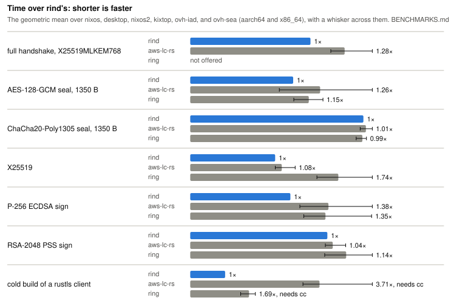

<h1 align="center">rind</h1>


> **rind** distills great cryptography into a pure-Rust library for
> [rustls](https://github.com/rustls/rustls) and
> [MoQ](https://github.com/moq-dev/moq), as fast as aws-lc-rs and ring and
> built by rustc alone.

- **No C toolchain.** rind's assembly lives in Rust source, so `cargo build`
  needs only rustc and a linker: no C compiler, cmake, nasm, or perl, for
  the host or a cross target. A rustls client builds faster over rind than
  over aws-lc-rs or ring.
- **Verified where it counts.** On x86_64 and aarch64, rind's elliptic-curve,
  RSA, and ML-KEM arithmetic builds on [s2n-bignum]'s formally verified
  assembly, and rind's own [Lean proofs][proofs] carry X25519 and Ed25519
  from its API down to it, as [Verified code][verified] lists. rind prefers
  verified code, and [ALGORITHMS.md][algorithms] marks ⚡ each place it runs
  faster unverified code instead.
- **As fast as aws-lc-rs and ring.** rind matches or beats both on nearly
  every operation TLS and QUIC run, from the handshake to each packet's
  AEAD. Where another library is ahead, as ring and aws-lc-rs are at
  RSA-2048 signing on x86_64, and aws-lc-rs is at AES-GCM and short messages
  on Apple silicon, where rind alone sets DIT around each call,
  [Known gaps][gaps] says so, with the quest that closes the gap or the
  reason it stays.

<picture>
  <source media="(prefers-color-scheme: dark)" srcset="https://raw.githubusercontent.com/moq-dev/rind/main/benchmarks/headline-dark.svg">
  
</picture>

[BENCHMARKS.md][benchmarks] has the times behind this chart: every
operation on each host and CPU tier, against aws-lc-rs, ring, RustCrypto,
Graviola, libcrux, and OpenSSL, with each library's build time, binary size,
and build tools.

## Usage

[](https://github.com/moq-dev/rind/actions/workflows/build.yml?query=branch%3Amain)
[](https://crates.io/crates/rind)
[](https://docs.rs/rind/)

rind is new, so exercise due caution.

### With rustls

[rind-rustls][] is a rustls `CryptoProvider`. Turn off rustls's default
features, which compile aws-lc-rs:

```toml
[dependencies]
rind-rustls = "0.23"
rustls = { version = "0.23", default-features = false, features = ["std", "tls12"] }
```

Install it at startup, then use rustls as normal:

```rust,ignore
// Refuses a CPU missing a feature rind requires.
rind_rustls::default_provider()?.install_default().unwrap();
```

Its [README][rind-rustls] shows a provider that links only the algorithms a
binary names.

### Directly

The `rind` crate's own API covers AES-GCM, ChaCha20-Poly1305, and
XChaCha20-Poly1305, QUIC header protection, X25519 and ECDH, ML-KEM-768,
ECDSA, Ed25519, and RSA signatures, RSA-OAEP, SHA-1, SHA-2, and SHA-3, HMAC,
HKDF, PBKDF2, and AES key wrap. Each algorithm is a constant and each key
type has one role, so misuse fails to compile:

```rust
use rind::signature::{EcdsaKeyPair, PublicKey, sign, verify};

fn main() -> Result<(), Box<dyn std::error::Error>> {
    // An error naming the missing CPU feature, rather than a panic later.
    rind::cpu::check()?;

    let key_pair = EcdsaKeyPair::generate(&sign::ECDSA_P256_SHA256_ASN1)?;
    let signature = key_pair.sign(b"hello")?;

    let encoded = key_pair.public_key();
    let public_key = PublicKey::new(&verify::ECDSA_P256_SHA256_ASN1, encoded.as_ref())?;
    public_key.verify(b"hello", signature.as_ref())?;
    Ok(())
}
```

[docs.rs][docs] documents every module, and [ARCHITECTURE.md][architecture]
describes the API's shape.

### Other adapters

Each crate's README shows its setup.

| Crate | For |
|---|---|
| [rind-ring][] | ring 0.17's API, name for name: rename the dependency, with no code changes |
| [rind-dimpl][] | DTLS 1.2 and 1.3 through [dimpl](https://github.com/algesten/dimpl) |
| [rind-jsonwebtoken][] | JWTs through [jsonwebtoken](https://github.com/Keats/jsonwebtoken) |
| [rind-object-store][] | S3, Azure, and GCS request signing through [object_store](https://github.com/apache/arrow-rs-object-store) |
| [rind-rcgen][] | certificates through [rcgen](https://github.com/rustls/rcgen) |
| [rind-instant-acme][] | ACME through [instant-acme](https://github.com/djc/instant-acme), unpublished until instant-acme releases the interface it targets |
| [rind-python][] | Python, as the `pyrind` package on PyPI, with rind's own API |

### Platforms

rind runs on x86_64, aarch64, and 32-bit arm, and fails to compile for any
other architecture. CI tests Linux (glibc and musl), macOS, and Windows on
x86_64 and aarch64, iOS in the simulator, and Android on aarch64, armv7, and
x86_64. Any x86_64 CPU runs it,
aarch64 needs NEON, and every operation panics on a CPU missing a feature
rind requires: call `rind::cpu::check()` at startup to get an error naming
it instead, as `rind_rustls::default_provider()` does.
[PLATFORMS.md][platforms] lists what each architecture runs without each
feature.

## Migrating with an agent

Paste this into your coding agent, in your repository:

```text
Move this repository from ring or aws-lc-rs to rind, following
https://raw.githubusercontent.com/moq-dev/rind/main/MIGRATE.md
```

It migrates on a local branch, reports the build time, binary size,
benchmarks, and tests before and after, and asks before opening a PR or
filing an issue. To migrate by hand, [MIGRATING.md][migrating] maps each
ring and aws-lc-rs item to rind's.

## Contributing

AI reviews and contributions are welcome. rind plans its work as quests,
Markdown files under [`quest/`][quests], with skills for Claude Code and
Codex. With [quest][quest-setup] installed, have your agent run
`/quest-plan` to propose a change or report a finding, or `/quest-start` to
take a quest from the backlog. [CONTRIBUTING.md][contributing] covers
building, testing, and how a PR lands.

## Learn more

- [ALGORITHMS.md][algorithms]: whose code runs each algorithm on each CPU,
  what of it is formally verified, its sources and their licenses, and how
  the main paths work.
- [PLATFORMS.md][platforms]: the CPU features each architecture requires, and
  what runs without the optional ones.
- [ARCHITECTURE.md][architecture]: the API's design, its modules, and the
  layers beneath them.
- [BENCHMARKS.md][benchmarks]: every operation's time, build time, and binary
  size, against the other libraries.

## Built on great work

rind began as a fork of [Graviola] by Joe Birr-Pixton, and no longer tracks
it. **Graviola is an outstanding project**: a fast, carefully designed
cryptography library with a refreshingly simple Rust-only build. rind owes
it its starting point, much of its code, and the example it follows. If
Graviola covers your needs, please give it a look and support its authors.

**[aws-lc-rs] is excellent, too.** It is the library we would use if we did
not need to build without C. AWS-LC supplies many of rind's implementations,
and aws-lc-rs is our reference for behavior, differential tests, and
performance.

The credit for the underlying algorithms, implementations, and proofs
belongs to their authors, including [s2n-bignum], [HACL\*], [libcrux],
[fiat-crypto], and the other projects [ALGORITHMS.md lists][sources]. rind's
contribution is to distill and integrate their work.

The rind logo is a tribute to [Graviola's fruit illustration][graviola-logo],
reimagined as a curled strip of its protective rind. A [wordmark][rind-wordmark]
for dark backgrounds starts white `ind` beneath the curl and extends it to
the right.

## License

rind's own code is licensed under Apache-2.0 OR ISC OR MIT-0. Code copied
from other projects keeps its source's license, which [LICENSE] lists.

[Graviola]: https://github.com/ctz/graviola
[graviola-logo]: https://github.com/ctz/graviola/blob/main/admin/picture.png
[rind-wordmark]: https://raw.githubusercontent.com/moq-dev/rind/main/admin/wordmark.svg
[aws-lc-rs]: https://github.com/aws/aws-lc-rs
[s2n-bignum]: https://github.com/awslabs/s2n-bignum
[HACL\*]: https://github.com/hacl-star/hacl-star
[libcrux]: https://github.com/cryspen/libcrux
[fiat-crypto]: https://github.com/mit-plv/fiat-crypto
[docs]: https://docs.rs/rind/
[quest-setup]: https://github.com/moq-dev/quest/blob/main/SETUP.md
[LICENSE]: https://github.com/moq-dev/rind/blob/main/LICENSE
[rind-rustls]: https://github.com/moq-dev/rind/tree/main/rind-rustls
[rind-ring]: https://github.com/moq-dev/rind/tree/main/rind-ring
[rind-dimpl]: https://github.com/moq-dev/rind/tree/main/rind-dimpl
[rind-jsonwebtoken]: https://github.com/moq-dev/rind/tree/main/rind-jsonwebtoken
[rind-object-store]: https://github.com/moq-dev/rind/tree/main/rind-object-store
[rind-rcgen]: https://github.com/moq-dev/rind/tree/main/rind-rcgen
[rind-instant-acme]: https://github.com/moq-dev/rind/tree/main/rind-instant-acme
[rind-python]: https://github.com/moq-dev/rind/tree/main/rind-python
[quests]: https://github.com/moq-dev/rind/blob/main/quest/README.md
[contributing]: https://github.com/moq-dev/rind/blob/main/CONTRIBUTING.md
[migrating]: https://github.com/moq-dev/rind/blob/main/MIGRATING.md
[benchmarks]: https://github.com/moq-dev/rind/blob/main/BENCHMARKS.md
[gaps]: https://github.com/moq-dev/rind/blob/main/BENCHMARKS.md#known-gaps
[verified]: https://github.com/moq-dev/rind/blob/main/BENCHMARKS.md#verified-code
[proofs]: https://github.com/moq-dev/rind/blob/main/proofs/README.md
[algorithms]: https://github.com/moq-dev/rind/blob/main/ALGORITHMS.md
[sources]: https://github.com/moq-dev/rind/blob/main/ALGORITHMS.md#sources
[platforms]: https://github.com/moq-dev/rind/blob/main/PLATFORMS.md
[architecture]: https://github.com/moq-dev/rind/blob/main/ARCHITECTURE.md
